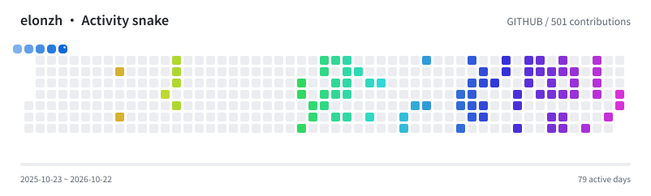
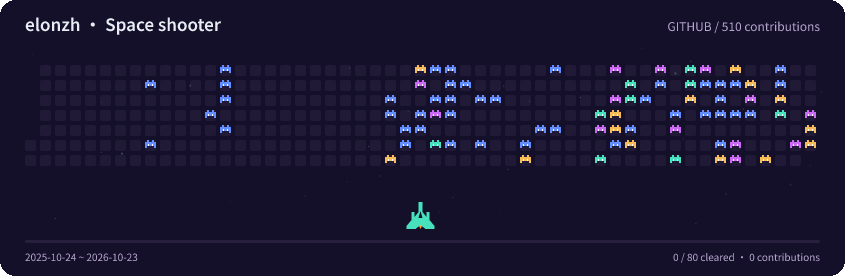
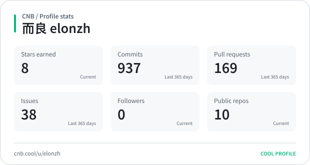
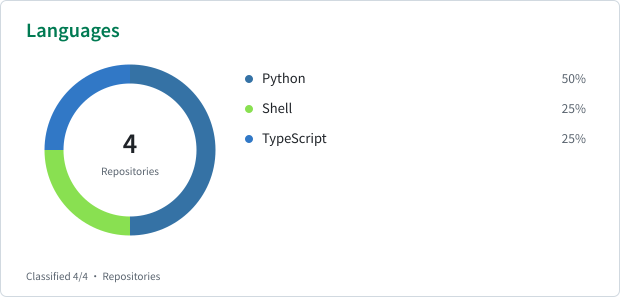
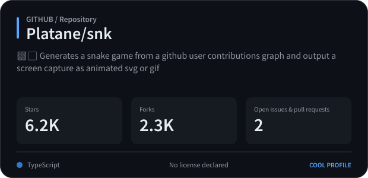
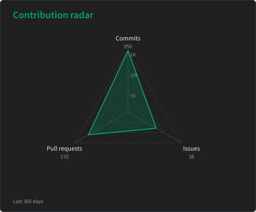
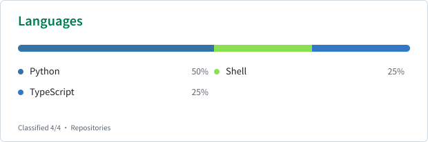
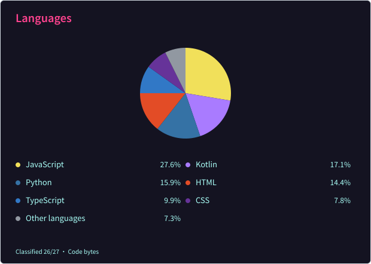

# Cool Profile

[简体中文](README.md) · [Gallery](https://elonzh.github.io/cool-profile/?ui=en)

Turn changing information into images and animations for your profile, README, or website.

Supports GitHub and CNB, with Chinese as the default, English output, and multiple themes. Includes snake
animations, space shooters, 3D activity calendars, and statistics cards.

## Preview
















Language cards offer bars, compact bars, horizontal and vertical donuts, and pies. Stats and repository cards support 67 themes. The 3D card combines the city, radar, and language chart, with standalone views available.







## CLI

Install with Node.js 24+:

```sh
npm install -g cool-profile
coolp --version
```

Or run without a global install: `npx cool-profile render activity/snake --source cnb --subject elonzh --locale en --output snake.svg`.

Docker Hub and CNB provide the same image, including both the CLI and server:

```sh
docker run --rm -v "$PWD:/workspace" -e CNB_TOKEN \
  elonzh/cool-profile:latest render activity/snake --source cnb --subject elonzh --locale en --output snake.svg
```

You can replace the image with `docker.cnb.cool/elonzh/cool-profile:latest`. Use a version tag such as `:0.1.0` to select a release; `:next` tracks prereleases and `:edge` on CNB tracks main builds.

[GitHub Releases](https://github.com/elonzh/cool-profile/releases) also provides the npm tarball and SHA-256 checksums. Install a downloaded tarball with `npm install -g ./cool-profile-0.1.0.tgz`.

GitHub stats and calendars use `GITHUB_TOKEN`; CNB uses `CNB_TOKEN`. CNB tokens need `account-profile:r` and
`account-engage:r`; repository cards also need `repo-basic-info:r`.

```sh
coolp render activity/snake --source cnb --subject elonzh --locale en --output snake.svg
coolp render activity/snake --source github --subject elonzh --format gif --theme rainbow --locale en --output snake.gif
coolp render activity/city --source cnb --subject elonzh --format png --theme blocks --locale en --output city.png
coolp render activity/shooter --source github --subject elonzh --theme arcade --locale en --output shooter.gif
coolp render profile/stats --source cnb --subject elonzh --locale en --output stats.svg
coolp render profile/stats --source github --subject elonzh --format png --theme dark --locale en --output stats.png
coolp render profile/languages --source cnb --subject elonzh --layout compact --theme tokyonight --locale en --output languages.svg
coolp render profile/radar --source cnb --subject elonzh --theme dark --locale en --output radar.svg
coolp render repository/overview --source github --subject Platane/snk --theme dark --locale en --output repo.svg
```

Replace subject with your account, or a full repository path for repo cards. Languages default to code bytes on
GitHub and repository counts on CNB. Use `--metric repositories` on either platform to count repos by primary
language.

For batch output, use `coolp batch --config coolp.yaml`; see the [configuration
example](docs/architecture.md#配置结构与下发).

## CNB plugin

Set `PROFILE_CNB_TOKEN` in your secret repository's `profile.yml`, then configure the pipeline:

```yaml
main:
  push:
    - imports:
        - https://cnb.cool/your-org/secrets/-/blob/main/profile.yml
      stages:
        - name: Generate profile animation
          image: docker.cnb.cool/elonzh/cool-profile:latest
          args: [render]
          settings:
            card: activity/snake
            params: { source: cnb, subject: elonzh }
            tokens: { cnb: $PROFILE_CNB_TOKEN }
            theme: dark
            locale: en
            output: profile/snake.svg
```

Use any card ID for `card` and its parameters for `params`. `format`, `theme` and `locale` have the same meaning as
their CLI options.

## GitHub Action

```yaml
steps:
  - uses: actions/checkout@v6
  - uses: elonzh/cool-profile@main
    with:
      card: activity/snake
      params: '{"source":"github","subject":"${{ github.repository_owner }}"}'
      theme: rainbow
      locale: en
      output: profile/snake.svg
```

The action uses the workflow's GitHub token by default. Use `github-token` or `cnb-token` to provide your own.

## Image server

```sh
docker run --rm -p 3000:3000 -e GITHUB_TOKEN -e CNB_TOKEN \
  docker.cnb.cool/elonzh/cool-profile:latest serve --host 0.0.0.0
```

Open `http://localhost:3000/?ui=en` to explore effects, edit parameters, generate images and copy commands, URLs or
configuration.

Use `http://localhost:3000/v1/cards/profile/stats.svg?source=cnb&subject=elonzh&locale=en` for a direct image.
Add `theme=dark` to change the theme, or use the `.png` extension for PNG output.

[GitHub](https://github.com/elonzh/cool-profile) · [CNB](https://cnb.cool/elonzh/cool-profile)
