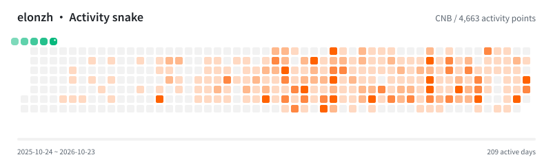
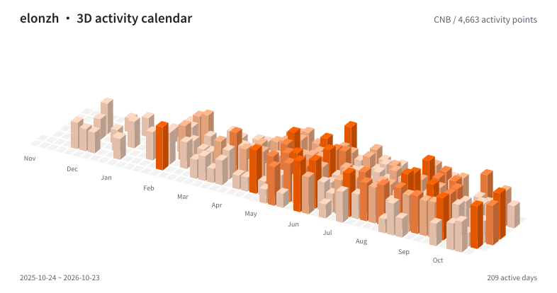
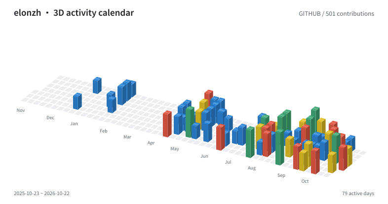
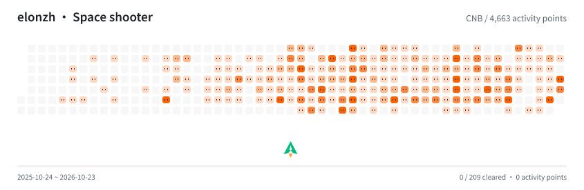
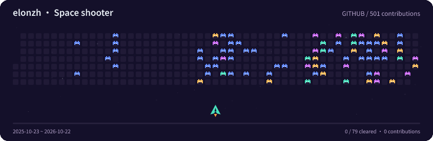
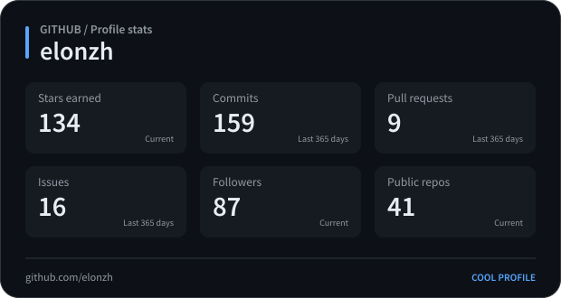
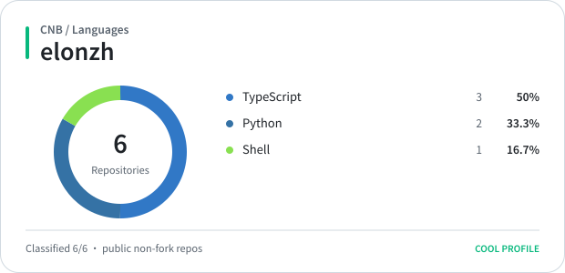

# Cool Profile

[简体中文](README.md)

Turn changing information into images and animations for your profile, README, or website.

Supports GitHub and CNB, with Chinese as the default, English output, and multiple themes. Includes snake animations, space shooters, 3D activity calendars, and statistics cards.

## Preview


















## Usage

Requires Node.js 24+ and pnpm. Run these commands once from the repository:

```sh
pnpm install --frozen-lockfile
pnpm build
```

GitHub stats and calendars use `GITHUB_TOKEN`; CNB uses `CNB_TOKEN`. CNB tokens need `account-profile:r` and `account-engage:r`; repository cards also need `repo-basic-info:r`.

```sh
pnpm coolp render snake --source cnb --subject elonzh --locale en --output snake.svg
pnpm coolp render snake --source github --subject elonzh --format gif --theme rainbow --locale en --output snake.gif
pnpm coolp render contrib-3d --source cnb --subject elonzh --format png --theme blocks --locale en --output city.png
pnpm coolp render space-shooter --source github --subject elonzh --theme arcade --locale en --output shooter.gif
pnpm coolp render stats --source cnb --subject elonzh --locale en --output stats.svg
pnpm coolp render stats --source github --subject elonzh --format png --theme dark --locale en --output stats.png
pnpm coolp render languages --source cnb --subject elonzh --locale en --output languages.svg
pnpm coolp render repo --source github --subject Platane/snk --theme dark --locale en --output repo.svg
```

Replace subject with your account, or a full repository path for repo cards. Languages default to code bytes on GitHub and repository counts on CNB. Use `--metric repositories` on either platform to count repos by primary language.

For batch output, use `pnpm coolp batch --config coolp.yaml`; see the [configuration example](docs/architecture.md#配置结构与下发).

Start the image server:

```sh
pnpm coolp serve
```

Open `http://localhost:3000/v1/cards/stats.svg?source=cnb&subject=elonzh&locale=en` to get an image. Add `theme=dark` to change the theme, or use the `.png` extension for PNG output.

[GitHub](https://github.com/elonzh/cool-profile) · [CNB](https://cnb.cool/elonzh/cool-profile)
