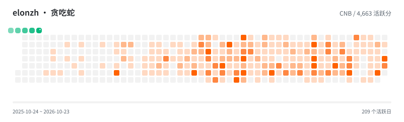
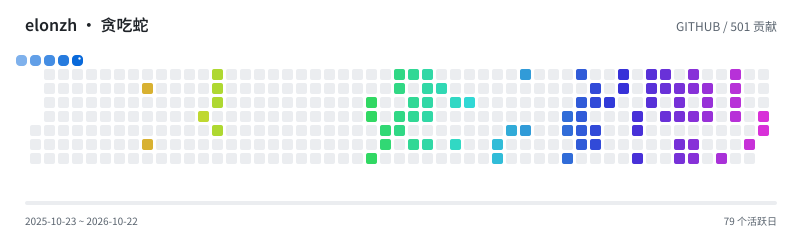
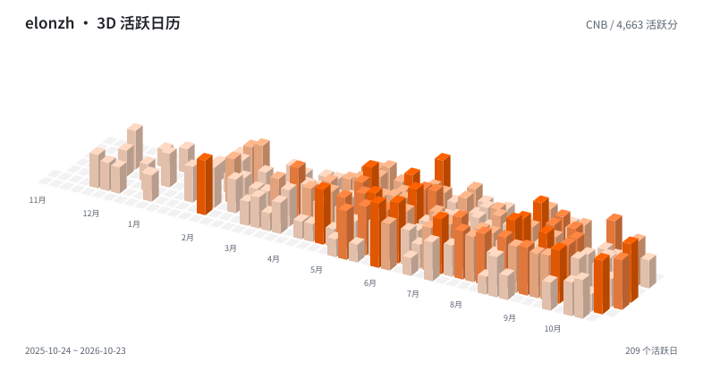
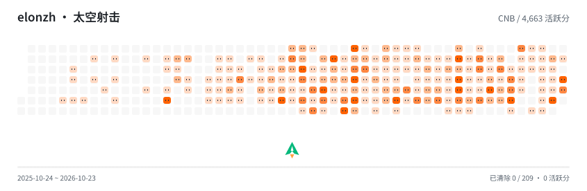
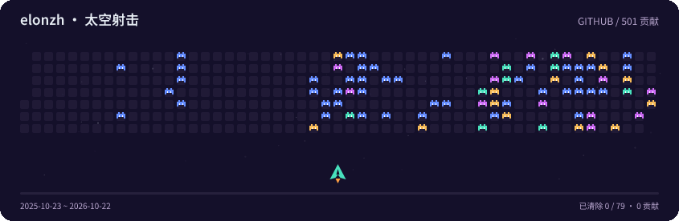
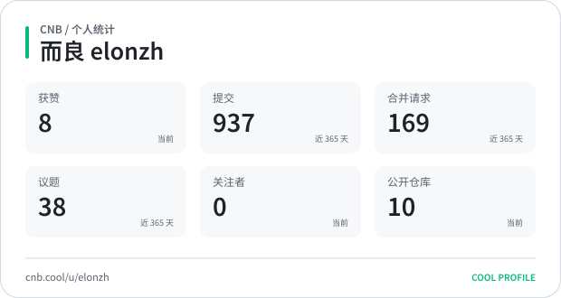
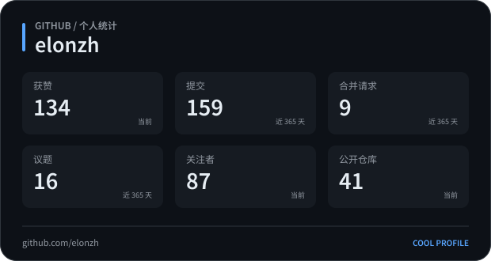

# Cool Profile

[English](README.en.md)

把动态信息变成图片与动画，嵌入个人主页、README 和网站。

支持 GitHub 与 CNB，默认中文，可选英文和多种主题。提供贪吃蛇、太空射击、3D 活跃日历和统计卡片。

## 效果

















## 命令行

使用镜像生成文件：

```sh
docker run --rm -v "$PWD:/workspace" -e CNB_TOKEN docker.cnb.cool/elonzh/cool-profile:latest render snake --source cnb --subject elonzh --output snake.svg
```

从源码运行需要 Node.js 24+ 和 pnpm。在仓库目录首次执行：

```sh
pnpm install --frozen-lockfile
pnpm build
```

GitHub 统计与日历使用 `GITHUB_TOKEN`，CNB 使用 `CNB_TOKEN`。CNB 令牌需要 `account-profile:r`、`account-engage:r`；仓库卡还需要 `repo-basic-info:r`。

```sh
pnpm coolp render snake --source cnb --subject elonzh --output snake.svg
pnpm coolp render snake --source github --subject elonzh --format gif --theme rainbow --output snake.gif
pnpm coolp render contrib-3d --source cnb --subject elonzh --format png --theme blocks --output city.png
pnpm coolp render space-shooter --source github --subject elonzh --theme arcade --output shooter.gif
pnpm coolp render stats --source cnb --subject elonzh --output stats.svg
pnpm coolp render stats --source github --subject elonzh --format png --theme dark --locale en --output stats.png
pnpm coolp render languages --source cnb --subject elonzh --output languages.svg
pnpm coolp render repo --source github --subject Platane/snk --theme dark --output repo.svg
```

将 subject 换成你的账号，仓库卡则填写完整仓库路径。语言卡默认统计 GitHub 代码字节、CNB 仓库数，使用 `--metric repositories` 可在两个平台上按主要语言统计仓库数。

批量生成使用 `pnpm coolp batch --config coolp.yaml`，配置方式见[配置示例](docs/architecture.md#配置结构与下发)。

## CNB 插件

在密钥仓库的 `profile.yml` 中设置 `PROFILE_CNB_TOKEN`，然后配置流水线：

```yaml
main:
  push:
    - imports:
        - https://cnb.cool/your-org/secrets/-/blob/main/profile.yml
      stages:
        - name: 生成主页动画
          image: docker.cnb.cool/elonzh/cool-profile:latest
          args: [render]
          settings:
            card: snake
            params: { source: cnb, subject: elonzh }
            tokens: { cnb: $PROFILE_CNB_TOKEN }
            theme: dark
            output: profile/snake.svg
```

`card` 可换成任意卡片 ID，`params` 填对应参数。`format`、`theme`、`locale` 与命令行同义。

## GitHub Action

```yaml
steps:
  - uses: actions/checkout@v6
  - uses: elonzh/cool-profile@main
    with:
      card: snake
      params: '{"source":"github","subject":"${{ github.repository_owner }}"}'
      theme: rainbow
      output: profile/snake.svg
```

默认使用工作流的 GitHub 令牌，也可通过 `github-token`、`cnb-token` 提供自己的令牌。

## 图片服务

```sh
docker run --rm -p 3000:3000 -e GITHUB_TOKEN -e CNB_TOKEN docker.cnb.cool/elonzh/cool-profile:latest serve --host 0.0.0.0
```

访问 `http://localhost:3000/v1/cards/stats.svg?source=cnb&subject=elonzh` 即可获取图片。添加 `theme=dark`、`locale=en` 切换主题和语言，路径后缀可改为 `.png`。

[GitHub](https://github.com/elonzh/cool-profile) · [CNB](https://cnb.cool/elonzh/cool-profile)
