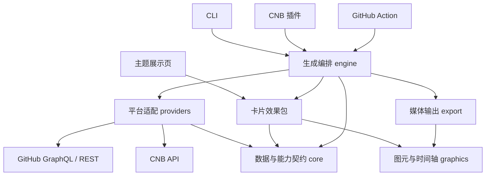

## 目标与当前状态

Cool Profile 用一套全新实现，为 GitHub 与 CNB 生成个人主页卡片和动画。参考项目用于理解效果、算法与交互；项目代码、包结构、数据模型和参数接口重新设计。

当前初始化 pnpm workspace、TypeScript、Oxc、prek 和双平台工程检查。下述包划分、功能、依赖及交付入口均为待确认方案，尚未实现。

## 职责与依赖

依赖从交付入口指向编排层，再指向平台、效果和编码包。平台与卡片之间只交换数据快照。令牌与网络状态归平台适配层；运动轨迹、布局和主题归效果及图形层；文件与发布行为归交付入口。

## 工作区划分

| 包或应用                      | 职责                                                                     |
| ----------------------------- | ------------------------------------------------------------------------ |
| `packages/core`               | 账号标识、日期窗口、指标单位、数据能力、快照及卡片契约；不依赖运行时 I/O |
| `packages/providers`          | GitHub 与 CNB 适配器；认证、分页、限流、请求去重、平台数据转换           |
| `packages/graphics`           | SVG 图元、文字排版、主题 token、语言资源、时间轴及动画序列化             |
| `packages/card-snake`         | 日历网格、可复现的寻路与贪吃蛇动画                                       |
| `packages/card-space-shooter` | 根据活跃网格生成敌机、攻击策略、战斗模拟和动画                           |
| `packages/card-contrib-3d`    | 等距投影、柱状日历、雷达和积木等样式                                     |
| `packages/card-stats`         | 总览、语言和仓库等统计卡；各卡片声明所需数据能力                         |
| `packages/export`             | SVG、PNG、GIF、WebP 输出，字体与帧编码；重型编码依赖按需加载             |
| `packages/engine`             | 配置解析、按卡片需求获取一次数据、选择主题和语言、生成产物清单           |
| `apps/cli`                    | 本地运行与配置文件入口；生成文件与结构化结果                             |
| `apps/cnb-plugin`             | CNB `settings` 参数适配、Docker 入口及构建工作区输出                     |
| `apps/github-action`          | GitHub Action `inputs` 适配，与 CNB 插件使用相同参数语义                 |
| `apps/gallery`                | 四类效果的主题和语言预览，输出配置与 README 嵌入代码                     |

按实现进度创建这些目录。平台适配器先放在同一个包中；新增平台实现同一契约并注册即可。四类效果独立演进，共享实际使用的图形原语。入口仅转换参数并调用 engine。

## 数据平台与统计语义

- 账号由平台、服务地址和用户名共同标识，允许同名账号和以后接入其他部署地址。
- 每次生成明确日期范围与时区。日历使用不受运行机器时区影响的日期键，补齐窗口内空白日期，保留平台官方强度等级。
- GitHub 日历保留贡献数量，CNB 日历保留活跃分；图中的单位、柱高说明、总量和提示文字随指标改变。
- 提交、Issue、PR、有效评审、仓库、Star、Fork、语言等分别建模，保留统计窗口和数据覆盖范围。语言占比同时注明统计依据，不能用仓库数量替代代码量。
- 用明确的数据能力表达可用、部分可用和不可用。未知指标不转换成零。编排层先检查卡片需求，卡片按有效数据选择对应布局。
- 同一账号与窗口的数据在一次任务内共享，按需要加载额外统计。缓存键包含平台、服务地址、账号、窗口和权限范围；缓存不保存令牌。
- 测试使用脱敏快照；真实账号样张另行生成，避免测试依赖外部接口和实时数据。

## 四类效果的范围

| 效果族   | 参考与拟实现内容                                                                                                                                                    |
| -------- | ------------------------------------------------------------------------------------------------------------------------------------------------------------------- |
| 贪吃蛇   | 参考 [Platane/snk](https://github.com/Platane/snk)：完整日历遍历、逐级消除、多配色、SVG/GIF 动画                                                                    |
| 太空射击 | 参考 [gh-space-shooter](https://github.com/czl9707/gh-space-shooter)：活跃格子化为敌机、行列及随机策略、粒子效果、GIF/WebP                                          |
| 3D 日历  | 参考 [github-profile-3d-contrib](https://github.com/yoshi389111/github-profile-3d-contrib)：等距柱图、雷达、生长动画、季节/夜景/彩虹/积木样式                       |
| 统计卡   | 参考 [github-stats-extended](https://github.com/stats-organization/github-stats-extended)：总览、语言、仓库卡；上游还提供 Gist 和 WakaTime 卡，需要确认是否纳入首期 |

GitHub 和 CNB 都有这四类效果。统计项按真实平台能力提供；WakaTime 是可选外部数据源，Gist 是 GitHub 特有资源，两者不能直接当作 CNB 自带统计。

## 渲染、语言与主题

效果包基于快照和显式随机种子计算布局或模拟，产出可复现的场景和时间轴。渲染过程不获取网络数据、不读取系统时钟。SVG 与动画帧使用同一份布局和模拟结果，保证静态预览、矢量动画及位图动画一致。

3D 效果采用等距 SVG 投影。统计卡使用共享排版和文本测量。SVG 是卡片及轻量动画的主要格式；太空射击优先保证 GIF/WebP 效果。PNG、GIF、WebP 编码置于 export 包，初步评估 `@resvg/resvg-js`、`gifenc`、`sharp`，用实际字体、动画体积和编码性能验证后选择。

中文与英文通过显式 `locale` 选择，默认 `zh-CN`，与数据平台无关。单位、日期、计数、雷达标签和提示文字全部进入语言资源。位图输出随发布包提供获准分发的中文字体，保持各运行环境排版一致。

主题使用语义 token，并允许各效果拥有专属参数。保留 CNB 官方活跃色阶与徽章绿、GitHub 原生色阶，以及可选择的季节、夜景、彩虹、积木和游戏主题。平台主题是默认选择，用户可覆盖。

主题展示页按效果、平台、主题、语言展示真实生成的样张。README 直接展示多主题代表效果并链接完整画廊。预览生成配置和实际流水线使用同一份配置结构。画廊拟采用 Vite 与 TypeScript，先加载构建时生成的样张，浏览器负责筛选、配置和复制嵌入代码。

## 工具链与交付

使用 Node.js 24+、TypeScript、pnpm workspace 与 catalog，包间使用 `workspace:*`。Oxlint/Oxfmt 和 prek 已纳入初始化；包构建拟用 `tsdown`，算法及适配验证拟用 Vitest。先使用 pnpm 的依赖顺序执行，出现实际构建瓶颈后再引入任务缓存工具。

CLI、CNB 插件和 GitHub Action 共享一个配置模型，至少包含数据平台、账号、日期窗口、效果、主题、语言和输出格式。一次任务可以批量生成多张卡及主题样张。Git 凭证和平台 API 令牌分开使用。

CNB 插件作为 Docker 镜像发布；GitHub Action 提供标准 `action.yml` 入口。生成与发布分开，文件可以保存到构建产物、`output` 分支或其他存储。两个平台都能调用同一生成器，默认使用各自任务内置令牌获取本平台数据。

CNB 与 GitHub 共用 `main`、版本号和提交历史。初始化阶段从本地顺序推送两个 remote 并核对提交 ID。建议 CNB 承担镜像及产物发布，GitHub 提供 Action 入口；以后自动镜像固定一个方向，避免互相触发同步。

## 验证与实施顺序

1. 确认本方案和统计卡首期范围。
2. 建立 core、双平台 providers、图形及编排基础，用两端真实日历跑通一个静态效果。
3. 实现统计与 3D 卡，再实现蛇和射击模拟；每类完成双平台、中文/英文及多主题验收。
4. 接入按需编码和批量样张，完成 CLI、CNB 插件、GitHub Action 与展示页。
5. 验证双端真实流水线、公开图片链接和双远程版本一致，再接入插件市场。

必要验证覆盖日期窗口与指标映射、确定性寻路和战斗、SVG 结构、中文文字及图形边界、各主题视觉回归、编码性能与实际流水线参数传递。以脱敏快照稳定复现测试，再用真实账号确认最终展示路径。

## 待确认

- 是否采用上述包边界与“同一生成器，CLI/CNB 插件/GitHub Action 三个入口”的交付方式。
- 是否以批量生成静态及动画文件为首期交付；动态图片 API 可以在同一 engine 上增加独立服务入口。
- 统计卡首期是否包含 Gist 与 WakaTime；建议先完成两端通用的总览、语言和仓库卡，两个特殊数据源随后接入。

## 工具链资料

- [pnpm workspace](https://pnpm.io/workspaces) 与 [catalog](https://pnpm.io/catalogs)
- [Oxlint 配置](https://oxc.rs/docs/guide/usage/linter/config) 与 [Oxfmt 配置](https://oxc.rs/docs/guide/usage/formatter/config)
- [prek 本地 hooks](https://prek.j178.dev/local-hooks/)
- [tsdown](https://tsdown.dev/)、[Vitest](https://vitest.dev/) 与 [Vite](https://vite.dev/)
- [resvg-js](https://github.com/thx/resvg-js)、[gifenc](https://github.com/mattdesl/gifenc) 与 [sharp](https://sharp.pixelplumbing.com/)
