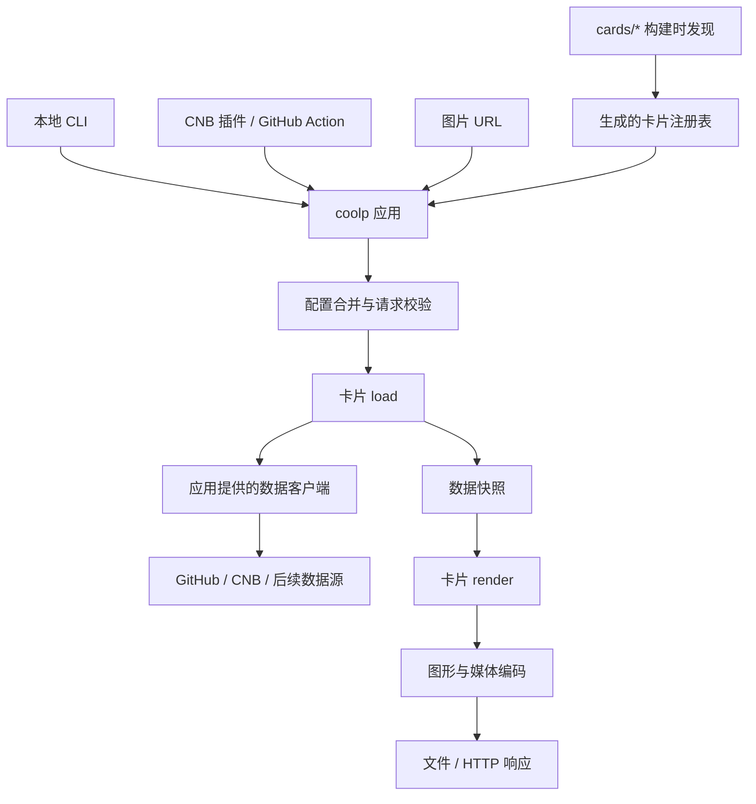

## 定位与范围

Cool Profile 将持续变化的信息生成为可嵌入个人主页、README 和网站的媒体卡片与动画。首期使用 GitHub 与 CNB 数据，重新实现贪吃蛇、太空射击、3D 活跃日历和统计卡片。后续接入 B 站、Steam 等来源，也允许一张卡片融合多种数据。

统一应用名为 `coolp`，包含 CLI 和 HTTP server。CNB 插件、GitHub Action 与服务部署共用应用和 OCI 镜像，通过子命令选择生成文件或启动服务。

当前已实现卡片协议、构建时发现、分层配置与来源诊断、可执行 coolp、HTTP 图片服务，以及 GitHub/CNB 的统计和日历数据适配器。stats 已提供中英文、明暗主题和 SVG/PNG 输出。其余效果、语言/仓库卡、统一镜像、CI 分发入口与画廊正在按本文实现。本文集中维护架构、卡片协议、配置、命令和 URL。README.md 默认中文，README.en.md 提供内容一致的英文版本。

## 职责与依赖



应用内一次生成依次完成配置解析、取数、绘制和编码，返回媒体内容、MIME、尺寸和动画信息。CLI 写文件，HTTP 路由返回响应。任务内的数据请求复用、跨请求缓存和凭证归应用管理。

| 路径                | 职责                                                               |
| ------------------- | ------------------------------------------------------------------ |
| `apps/coolp`        | CLI、server、配置、生成函数、注册表加载、缓存及交付                |
| `apps/gallery`      | 展示真实样张，根据卡片元信息生成命令、URL 和配置                   |
| `packages/card-kit` | 小型卡片协议：defineCard、上下文类型、参数 schema 约束及定义校验   |
| `packages/data`     | 数据能力、快照类型、适配器与认证、分页、限流；类型通过独立入口导出 |
| `packages/graphics` | 图元、排版、主题、语言格式化、时间轴及 SVG/PNG/GIF/WebP 编码       |
| `cards/*`           | 卡片代码包，各自维护参数、取数组合、布局或模拟、文案和样张         |

卡片依赖 card-kit、图形包及数据类型；应用装配具体数据客户端。load 可以调用该客户端组合多个数据源，HTTP 请求和令牌处理在数据适配器内完成。render 只消费已取得的快照，不访问网络、令牌或 Git。编码器按格式加载，图形与模拟代码不绑定 CLI 或 HTTP。

## 卡片 ID 与发现

卡片 ID 是稳定名称，可以是 `snake`、`bilibili/card-id` 或 `profile/overview`。每一段匹配 `[a-z0-9]+(?:-[a-z0-9]+)*`，段间用斜杠连接。ID 不含空段、点或扩展名，URL 仅在最后一段追加媒体扩展名。

命名空间由卡片作者选择。ID、npm 包名、目录名和数据源互相独立；`profile/overview` 可以同时使用 GitHub 与 CNB，`bilibili/card-id` 也可以使用其他来源的补充数据。

workspace 包含 `apps/*`、`packages/*` 和 `cards/*`。构建流程扫描 `cards/*/package.json` 中的 `coolp.card-entry`，入口统一导出 `cards` 数组。一个包可以提供多张相关卡片，例如 stats 包导出 stats、languages、repo。

```json
{
  "name": "@cool-profile/card-profile",
  "private": true,
  "type": "module",
  "coolp": {
    "card-entry": "./src/index.ts"
  },
  "dependencies": {
    "@cool-profile/card-kit": "workspace:*",
    "@cool-profile/graphics": "workspace:*",
    "zod": "catalog:"
  }
}
```

构建时校验卡片定义，再生成带静态模块路径的注册表；产物随应用打包进 CLI 和镜像。卡片目录无需部署到运行机器。新增包参与正常的 workspace 依赖安装及构建，不需要编辑中心注册列表、HTTP 路由或帮助文本。开发时重新构建即可发现新包。

注册校验包括 ID 唯一性、入口和导出有效性、格式/主题/语言列表、schema 可描述性、参数名冲突及默认值合法性。重复 ID 导致构建失败，不依赖扫描顺序覆盖。卡片模块的顶层初始化不请求网络或读取运行配置。

## 卡片协议与添加方式

参数使用 Zod 4 的严格对象 schema，作为 TypeScript 类型、运行时校验和参数说明的共同来源。通过 JSON Schema 导出字段类型和描述，供 CLI 帮助、URL 校验及画廊使用。card-kit 封装协议与定义校验。

以下是协议轮廓，Graphic、DataClient 等具体类型由对应包导出：

```ts
interface CardDefinition<S extends z.ZodObject, Data> {
  id: string;
  params: S;
  formats: readonly MediaFormat[];
  themes: readonly string[];
  locales: readonly string[];
  defaults?(media: MediaOptions): Partial<z.output<S>>;
  validate?(params: z.output<S>, media: MediaOptions): readonly ValidationIssue[];
  load(ctx: LoadContext, params: z.output<S>): Promise<Data>;
  render(ctx: RenderContext, data: Data, params: z.output<S>): Graphic | Promise<Graphic>;
}
```

- formats 第一项为默认格式；themes 包含 default，locales 包含 zh-CN，首期卡片同时提供 en。
- params 定义卡片参数的类型、必填项、范围和说明；根字段使用小写 kebab-case。format、theme、locale、seed、params 及 CLI 控制选项是保留名，不能重复声明。
- defaults 只提供卡片参数的默认值，可根据已确定的媒体格式选择，例如 3D 卡片在 SVG 下默认动画、PNG 下默认静态。schema 本身不使用 default、coerce 或 transform，避免在覆盖完成前补值或改变语义。
- validate 在完整参数解析后检查跨字段规则，例如 PNG 不接受 animate=true。
- LoadContext 提供受控 DataClient、AbortSignal 和本次请求的时间基准。RenderContext 提供规范化媒体设置和 text 排版函数，图元由图形包提供；绘图上下文没有数据客户端。应用持有共享缓存，每次生成创建独立上下文与配置，卡片定义不保存请求状态。

defineCard 将 load 和 render 封装为内部 prepare 方法，先取得快照，再返回保留类型信息的绘图函数。应用记录本次使用的快照版本及权限作用域，在绘图与编码之前查询媒体缓存。缓存仅属于应用实例；共享取数任务使用独立超时，某个 HTTP 客户端取消请求不取消其他消费者。

添加一张融合卡片时，在 `cards/profile` 放入上述 package.json，并实现 `src/index.ts`、绘图代码及样张。以下示例使用首期选定的两个来源：

```ts
import * as z from 'zod';
import { defineCard } from '@cool-profile/card-kit';
import { drawOverview } from './draw.js';

export const cards = [
  defineCard({
    id: 'profile/overview',
    params: z.strictObject({
      'github-user': z.string().min(1).describe('GitHub 账号'),
      'cnb-user': z.string().min(1).describe('CNB 账号'),
    }),
    formats: ['svg', 'png'],
    themes: ['default', 'dark'],
    locales: ['zh-CN', 'en'],
    async load(ctx, params) {
      const [github, cnb] = await Promise.all([
        ctx.data.read({
          source: 'github',
          kind: 'profile-stats',
          subject: params['github-user'],
        }),
        ctx.data.read({
          source: 'cnb',
          kind: 'profile-stats',
          subject: params['cnb-user'],
        }),
      ]);
      return { github, cnb };
    },
    render(ctx, data) {
      return drawOverview(data, ctx);
    },
  }),
];
```

绘图模块根据 ctx.media.locale 和主题排版，保留 GitHub 贡献数与 CNB 活跃分各自的名称、单位和范围。

新增卡片的完成路径：

1. 在 `cards/<package>` 实现导出定义、绘图和依赖；所需能力未存在时，在 packages/data 增加对应适配器或能力。
2. 运行 workspace 安装与应用构建，由发现步骤生成注册表；使用 CLI 帮助检查格式、主题和参数。
3. 通过 CLI 与 URL 生成同一请求，验收中英文、多主题和数据边界，补充画廊样张。算法或数据行为有风险时增加针对性验证。

## CLI 与 URL

```text
coolp render <card-id> [--config <file>] [options]
coolp batch [--config <file>] [--output-dir <directory>] [render-options]
coolp serve [--config <file>] [--host <address>] [--port <port>]
```

```sh
coolp render stats --source cnb --subject elonzh --format svg --theme dark --locale zh-CN --output dist/stats.svg
```

```text
GET /v1/cards/stats.svg?source=cnb&subject=elonzh&theme=dark&locale=zh-CN
```

按上节添加融合卡片包后，可使用自己的参数，不必声明 source 或 subject：

```sh
coolp render profile/overview --github-user elonzh --cnb-user elonzh --format svg --locale zh-CN --output dist/overview.svg
```

```text
GET /v1/cards/profile/overview.svg?github-user=elonzh&cnb-user=elonzh&locale=zh-CN
```

命名空间同样适用于未来卡片，以下仅说明寻址规则：

```sh
coolp render bilibili/card-id --uid 123 --format png --output dist/bilibili.png
```

```text
GET /v1/cards/bilibili/card-id.png?uid=123
```

| 语义     | CLI                         | URL / 配置                         |
| -------- | --------------------------- | ---------------------------------- |
| 卡片     | render 后的位置参数         | 路径中完整 ID；批量项为 card       |
| 格式     | --format                    | 路径扩展名；配置为 render.format   |
| 主题     | --theme                     | theme；配置为 render.theme         |
| 媒体语言 | --locale                    | locale；配置为 render.locale       |
| 随机种子 | --seed                      | seed；配置为 render.seed           |
| 卡片参数 | schema 中的 --字段名        | 同名查询参数；配置为 params.字段名 |
| 输出文件 | --output / -o               | CLI 交付设置，不进入图片 URL       |
| 运行配置 | --config、--host、--port 等 | 本地配置与环境变量，不进入图片 URL |

公共渲染默认值为 locale=zh-CN、theme=default、seed=0，seed 范围为 0..4294967295；格式采用当前卡片的默认值。source、subject、year、fps、strategy 等都是卡片声明的参数。单来源日历卡可声明 source 与 subject，融合卡可声明多个账号或其他输入。浏览器、终端和服务器地区设置不改变媒体语言。

CLI 省略 format、URL 省略扩展名时采用同一默认格式。URL 在最后一段识别格式，前面的斜杠完整保留在 ID 中；仅对各段解码一次，不把百分号编码的斜杠转换成 ID 分隔符。URL 不再提供 format 查询参数。文件扩展名不参与选格式，冲突时报参数错误。CLI 默认输出 `<完整 card-id>.<format>`，保留子目录；`--output -` 将媒体写入 stdout，日志写入 stderr。

卡片参数按 schema 解析：字符串保留字符串含义，数值使用不含指数的十进制表示，布尔只接受 true/false；数组、对象和包含多种 JSON 类型的联合类型在 CLI/URL 中使用 JSON，URL 按查询参数编码。重复查询键、未知选项和不支持的组合报错。

新增卡片的参数也可整体放进 `--params '<JSON 对象>'`，URL 使用同名 params 查询参数。对象内容对应配置中的 params 区域；与单独字段重复提供同一个参数时报错。CI 元数据可通过这一个输入传递新卡片参数，无需为每张卡扩展固定 inputs。

### 首期效果

| ID                     | 参考                                                                                  | 默认 / 允许格式 |
| ---------------------- | ------------------------------------------------------------------------------------- | --------------- |
| snake                  | [Platane/snk](https://github.com/Platane/snk)                                         | svg / svg、gif  |
| space-shooter          | [gh-space-shooter](https://github.com/czl9707/gh-space-shooter)                       | gif / gif、webp |
| contrib-3d             | [github-profile-3d-contrib](https://github.com/yoshi389111/github-profile-3d-contrib) | svg / svg、png  |
| stats、languages、repo | [github-stats-extended](https://github.com/stats-organization/github-stats-extended)  | svg / svg、png  |

参考用于理解算法与效果，代码重新实现。四类效果同时支持 GitHub/CNB，统计卡使用来源实际提供的指标。Gist/WakaTime 首期范围仍待确定。

日历卡缺省读取最近 365 天，year 指定来源时区下的日历年份。累计指标保留原始统计范围。太空射击 strategy 支持 column、row、random，默认 random；fps 默认 40。3D 的 animate 在 SVG 下默认 true、PNG 下默认 false。

图形包提供基础图元、时间轴和编码，各卡片维护自己的布局、模拟及文案。CNB 默认活跃色阶与徽章绿、GitHub 原生色阶，以及季节、夜景、彩虹、积木和游戏主题随效果实现。字体随镜像分发，每类效果以真实数据验收中英文与多主题样张。

## 配置结构与下发

配置按作用域区分：

| 区域             | 内容                                                   | 可由图片请求覆盖             |
| ---------------- | ------------------------------------------------------ | ---------------------------- |
| runtime          | server、日志、数据客户端、缓存、凭证引用、文件输出目录 | 否                           |
| defaults         | 所有卡片的公共渲染默认值：format、theme、locale、seed  | 是                           |
| cards[id].render | 指定卡片的公共渲染设置                                 | 是                           |
| cards[id].params | 指定卡片的业务参数，受该卡片 schema 约束               | 是                           |
| jobs[]           | batch 的 card、render、params、output                  | CLI batch 公共渲染选项可覆盖 |

defaults 只接收公共渲染字段，不向所有卡片广播 source 等业务参数。cards 的键始终是完整 ID，带斜杠时作为普通字符串键。runtime 中的凭证、服务地址与缓存设置不进入卡片 schema。

配置支持 YAML 与 JSON，结构相同。示例 coolp.yaml：

```yaml
runtime:
  server:
    host: 127.0.0.1
    port: 3000
  log-level: info
  output-dir: dist
  cache:
    ttl: 300
  providers:
    github:
      token-env: GITHUB_TOKEN
    cnb:
      token-env: CNB_TOKEN

defaults:
  locale: zh-CN
  theme: default

cards:
  stats:
    render:
      theme: dark
    params:
      source: cnb
      subject: elonzh

jobs:
  - card: stats
    output: cnb-stats.svg
  - card: stats
    render:
      locale: en
    params:
      source: github
      subject: elonzh
    output: github-stats.svg
```

配置文件选择顺序为 `--config`、插件的 PLUGIN_CONFIG、`COOLP_CONFIG`、当前目录的 coolp.yaml / coolp.yml / coolp.json。应用入口选定显式路径后交给共用加载器；自动发现只检查当前目录，存在多个候选文件时报错。render 与 serve 没有文件时使用内置默认值及环境变量，batch 需要有 jobs 的配置。显式指定的文件不存在时报错。

配置文件中的相对路径以文件目录为基准，CLI 或环境变量中的相对路径以工作目录为基准。batch 的 output 相对最终 output-dir 解析，重复输出目标在生成前报错。render 不读取 jobs 中的参数；batch 按每项 card 选择对应定义；serve 不执行 jobs。

### 环境变量

runtime 和 defaults 使用 `COOLP__<区域>__<字段>`，双下划线分层，字段转大写并将连字符转为单下划线。cards 使用一个 JSON 对象覆盖映射，ID 保持原样：

```sh
export COOLP__RUNTIME__SERVER__PORT=8080
export COOLP__RUNTIME__LOG_LEVEL=debug
export COOLP__DEFAULTS__LOCALE=en
export COOLP__CARDS='{"stats":{"params":{"subject":"another-user"}}}'
```

COOLP__CARDS 的值与文件的 cards 区域同构，可同时设置多张卡的 render 和 params，也支持含斜杠的 ID。这样无需把 ID 编码成有歧义的环境变量名。数组和对象使用 JSON，标量依据 schema 转换；空字符串保留为空值，不能隐式表示未配置。未知 COOLP__ 字段报错。其他应用或系统环境变量不参与参数合并。

同一组环境变量不能同时给父对象和子字段赋值，例如 COOLP__RUNTIME__SERVER 与 COOLP__RUNTIME__SERVER__PORT 同时存在会报冲突，避免覆盖取决于变量枚举顺序。

provider 的 token-env 指定凭证环境变量名，GitHub/CNB 默认分别使用 GITHUB_TOKEN、CNB_TOKEN；使用数据源时按适配器的认证要求解析，未使用的来源不强制提供凭证。不执行通用字符串插值。凭证值不属于请求参数，错误和配置预览均脱敏。

### 覆盖顺序

运行配置按以下顺序覆盖，右侧优先：

```text
应用内置 runtime 默认值
  < 文件 runtime
  < COOLP__RUNTIME__*
  < 插件运行设置
  < 启动命令的运行选项
```

单张卡的生成配置按以下顺序覆盖，右侧优先：

```text
公共媒体默认值与卡片 defaults
  < 文件 defaults
  < 文件 cards[完整 ID]
  < 当前 batch job
  < 环境 defaults
  < 环境 cards[完整 ID]
  < CNB 插件 settings 输入
  < 显式 CLI 参数或 HTTP 请求
```

先按相同来源内的作用域合并，再按来源优先级覆盖。因此环境中的全局 locale 可以覆盖文件中某张卡的 locale，URL 中的 locale 又能覆盖环境值。CLI 与 URL 的最终请求使用同一套函数，不从进程全局状态修改卡片定义。

以上述文件和环境变量为例，执行 `coolp render stats --locale zh-CN --dry-run` 会得到 source=cnb、subject=another-user、theme=dark、locale=zh-CN：账号来自环境的卡片配置，主题来自文件的卡片配置，语言来自本次命令。

先确定媒体设置，再用这些设置计算卡片参数 defaults，最后应用各层 params。defaults 函数只确定最低优先级的值，不能覆盖用户参数。对象递归合并，标量与数组整体替换；字段缺省表示沿用低层，null 仅在 schema 明确允许时有效，不作为删除指令。

batch 的 --locale、--theme、--format、--seed 覆盖每项公共媒体设置；卡片参数在各 job 或 cards[id].params 中配置，batch 不接受某一张卡专属的命令参数。serve 的启动选项只配置 runtime，每个请求的卡片参数由 URL 指定并覆盖部署默认值。

CNB settings 转为 PLUGIN_* 后，由 render 的输入适配器读取，card 可来自 PLUGIN_CARD。公共字段映射到媒体、交付或运行设置，其余字段按当前卡片 schema 映射到 params。适配器将环境变量名中的下划线归一为连字符，也接受保留连字符的键；归一后重复的字段会报错。PLUGIN_PARAMS 支持整个 params 的 JSON，同一字段同时由 PLUGIN_PARAMS 和独立 settings 提供时报重复输入错误。GitHub Action inputs 映射为命令参数。此适配层不再定义一套默认值。

### 校验与诊断

1. 读取每个配置来源时检查结构、未知卡片 ID、未知字段、键重复、类型及当前可判定的范围。配置片段的对象递归允许缺省字段，只检查已提供的内容，不在本层填默认值或执行跨字段校验；错误即报告，不被更高层覆盖掩盖。
2. 合并选中卡片的媒体设置，验证格式、主题、语言等能力；再计算默认参数、合并 params，执行完整 schema 和跨字段校验。缺失必填值在此时报错。
3. batch 在取数前校验所有 job 和输出目标。serve 在开始监听前校验 runtime 和卡片默认配置片段，卡片必填参数允许由请求补齐；每个请求再检查覆盖后的完整值。各次生成使用独立的不可变配置。
4. 错误包含字段路径、来源和原因，例如 `COOLP__RUNTIME__SERVER__PORT: expected integer 1..65535` 或 `coolp.yaml: cards.snake.params.subject: required`；所有来源信息保留到规范化完成，凭证值脱敏。

`coolp render <id> --dry-run` 与 `coolp batch --config coolp.yaml --dry-run` 输出最终配置、字段来源和目标文件，完成同样的校验，不调用数据源或编码器。serve 首期在启动时读取文件和环境，不自动热更新配置。

## 数据、媒体与 server

数据按日历、资料、统计、仓库等能力组织，卡片按需组合快照。资源由来源、服务地址、来源内 ID 标识；数据请求缓存键包含能力、资源、查询与权限作用域。快照保留采集时间、刷新建议、缺失值、单位和统计范围。

时间窗口显式解析，绘制和模拟使用已固定的数据、语言、主题、时间与随机种子，避免依赖机器时区及系统时间。GitHub 日历按 UTC 日期、CNB 按 Asia/Shanghai 日期解析，统计卡的提交、议题和合并请求使用最近 365 天的平台计数；获赞汇总完整分页的公开 Owner 仓库，公开仓库数使用平台资料字段。CNB 活跃分与 GitHub 贡献数保留各自名称与等级语义。HTTP、响应结构或认证失败直接报错，不替换成零值。

Noto Sans SC 可变字体及 OFL 授权文件随应用放在 assets/fonts。Fontkit 根据字体生成文字矢量路径，text 支持字重、测量、对齐和省略；SVG 保留可访问名称，渲染时不依赖系统字体或外部字体服务。PNG 由 resvg-js 使用同一份 SVG 生成。原生编码依赖从 bundle 外加载，应用包声明运行依赖；GIF/WebP 编码随动画效果接入。

server 本地默认监听 127.0.0.1:3000，容器显式使用 host=0.0.0.0。GET/HEAD `/v1/cards/<完整 ID>[.<format>]` 交付媒体，设置 Content-Type 与基于内容的 ETag，支持缓存和条件请求。媒体缓存键包含最终规范化参数、数据版本、权限作用域和渲染版本，不包含 CLI 文件位置。

CLI 参数错误退出码为 2，生成失败为 1；HTTP 参数错误返回 400，卡片或资源不存在返回 404，上游调用失败返回 502，错误使用结构化 JSON。runtime 字段和访问令牌不能从 URL 注入。

## 镜像与 CI

拟发布镜像 `docker.cnb.cool/elonzh/cool-profile:latest`，包含 coolp、server、编码器与字体：

```dockerfile
ENTRYPOINT ["coolp"]
CMD ["--help"]
```

```sh
docker run --rm -p 3000:3000 docker.cnb.cool/elonzh/cool-profile:latest serve --host 0.0.0.0 --port 3000
```

CNB 插件运行同一镜像：

```yaml
$:
  web_trigger:
    - stages:
        - name: generate-profile
          image: docker.cnb.cool/elonzh/cool-profile:latest
          args: [render]
          settings:
            card: snake
            source: cnb
            subject: elonzh
            format: svg
            theme: dark
            locale: zh-CN
            output: dist/snake.svg
```

根 action.yml、插件元数据和 Dockerfile 负责分发及输入适配。GitHub Docker Action 调用同一镜像的 coolp render。args 追加到 ENTRYPOINT 并替换 CMD；插件和 server 通过子命令运行。CI 生成工作区文件，Git 提交、制品上传和部署由后续流水线步骤负责。仓库流水线镜像使用 latest 等浮动标签，遵循已确定的配置取舍。

## 工程与实施

Node.js 24+、TypeScript、pnpm workspace 与 catalog，内部依赖用 workspace 协议。Oxlint、Oxfmt 和 prek 已配置。卡片参数使用 Zod 4，tsx 执行发现脚本，Vitest 验证行为，tsdown 打包 ESM 可执行文件。画廊拟用 Vite 与 TypeScript。esbuild 的依赖安装脚本仅在项目 allowBuilds 中启用，用于 tsx 执行 TypeScript，不安装全局工具。

```sh
pnpm install --frozen-lockfile
pnpm hooks:install
pnpm check
pnpm cards:discover
pnpm build
pnpm coolp render stats --source cnb --subject elonzh --output stats.svg
pnpm sync:remotes
```

格式及风格检查交给提交钩子，修复后检查差异、重新暂存再提交。功能验证覆盖注册发现、配置覆盖与类型转换、CLI/URL 请求一致性、数据语义、确定性模拟、文字与图形边界及媒体交付。测试针对行为风险，不为简单配置堆叠实现镜像式断言。

pnpm cards:discover 校验 cards/* 的实际导出并生成 generated/cards.ts，应用构建导入这份注册表。generated/ 不提交到 Git，CI 检查会重新生成。

pnpm build 先发现卡片，再生成 apps/coolp/dist/coolp.mjs；该文件可直接通过 Node 或其 shebang 运行。开发时 pnpm coolp 使用相同入口。完整检查在测试前构建，CLI 集成测试执行真实 bundle，HTTP 测试使用本地 API 服务，不依赖外部令牌；真实样张保存在各卡片包的 examples/。

实施顺序为协议及发现、配置与数据/图形基础、首张卡片的 CLI 和 server、四类效果及多语言样张，随后完成统一镜像、CI 入口、画廊和插件市场。

origin 为 [CNB](https://cnb.cool/elonzh/cool-profile)，github 为 [GitHub](https://github.com/elonzh/cool-profile)。两个远程共用 main、提交历史和版本号；pnpm sync:remotes 顺序推送，完成后核对两个远程 SHA。提交使用中文 Conventional Commit 标题，正文说明实现与验证。

## 技术依据

- [Zod 严格对象、类型推导和校验](https://zod.dev/api)、[JSON Schema 导出](https://zod.dev/json-schema)
- [YAML 配置解析](https://github.com/eemeli/yaml)
- [Fontkit](https://github.com/foliojs/fontkit)、[Noto Sans SC](https://github.com/google/fonts/tree/main/ofl/notosanssc)
- [GitHub 用户 API](https://docs.github.com/en/rest/users/users)、[仓库 API](https://docs.github.com/en/rest/repos/repos)、[CNB Open API](https://docs.cnb.cool/zh/develops/openapi.html)
- [pnpm workspace](https://pnpm.io/workspaces)、[catalog](https://pnpm.io/catalogs)
- [Oxlint](https://oxc.rs/docs/guide/usage/linter/config)、[Oxfmt](https://oxc.rs/docs/guide/usage/formatter/config)、[prek](https://prek.j178.dev/local-hooks/)
- [tsdown](https://tsdown.dev/)、[Vitest](https://vitest.dev/)、[Vite](https://vite.dev/)
- [resvg-js](https://github.com/thx/resvg-js)、[gifenc](https://github.com/mattdesl/gifenc)、[sharp](https://sharp.pixelplumbing.com/)
- [CNB 插件 settings](https://docs.cnb.cool/zh/build/create-plugin.html)、[Job args](https://docs.cnb.cool/zh/build/grammar.html#job-args)
- [GitHub Docker Action args](https://docs.github.com/en/actions/reference/workflows-and-actions/metadata-syntax#runsargs)、[Docker ENTRYPOINT 与 CMD](https://docs.docker.com/reference/dockerfile/#understand-how-cmd-and-entrypoint-interact)
