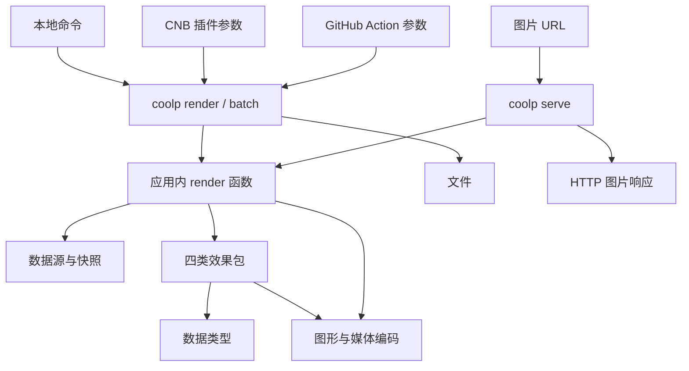

## 定位与范围

Cool Profile 将持续变化的信息生成为可嵌入个人主页、README 和网站的媒体卡片与动画。首期使用 GitHub 与 CNB 数据，实现贪吃蛇、太空射击、3D 活跃日历和统计卡片。B 站、Steam 等数据源随后续需求接入。

应用命令名为 `coolp`，文件生成和 HTTP server 在同一个应用中实现。CNB 插件和 GitHub Action 负责在 CI 环境调用生成命令，共用应用代码、参数语义和容器镜像。

当前已初始化 pnpm workspace、TypeScript、Oxc、prek 和双平台工程检查。下述功能和包结构是待确认的实现方案，尚未实现。命令、URL、默认值和容器调用方式统一维护在[接口设计](interfaces.md)。

## 应用结构

一次生成的流程是校验参数、读取数据、调用对应效果、编码媒体。这段业务流程放在 `apps/coolp` 的普通 `render` 函数中，由命令行和 HTTP 路由复用。它返回媒体内容、MIME 类型、尺寸和动画信息，调用方负责写文件或返回响应。

server 是应用的组成部分，包含路由、参数转换、生成请求复用、缓存、条件请求和 HTTP 响应。CLI 与 server 进入同一个请求校验与默认值函数，媒体生成不受运行入口影响。

## 工作区划分

| 包或应用                      | 职责                                                                         |
| ----------------------------- | ---------------------------------------------------------------------------- |
| `apps/coolp`                  | 命令行、server、共享 render 函数、参数定义、数据源与效果注册、缓存和配置读取 |
| `apps/gallery`                | 按效果、数据源、语言和主题展示样张，生成命令与 URL 配置                      |
| `packages/data`               | 数据契约和 GitHub/CNB 适配器，按来源组织认证、分页、限流与快照读取           |
| `packages/graphics`           | 图元、排版、主题、语言格式化、时间轴，以及 SVG/PNG/GIF/WebP 编码             |
| `packages/card-snake`         | 网格遍历、寻路与贪吃蛇动画                                                   |
| `packages/card-space-shooter` | 敌机、攻击策略、战斗模拟和粒子效果                                           |
| `packages/card-contrib-3d`    | 等距柱图、雷达、生长动画及积木等样式                                         |
| `packages/card-stats`         | 总览、语言、仓库等统计卡                                                     |

`packages/data` 用独立类型入口导出数据契约，卡片通过类型导入使用快照。API 请求和令牌读取由应用调用数据适配器完成，卡片负责布局或模拟。`packages/graphics` 的矢量与位图编码使用不同模块入口，按格式加载原生依赖和字体。

`apps/coolp` 中的 CLI、HTTP、render 和配置按模块组织。根目录的 `action.yml`、插件元数据和 Dockerfile 负责分发及参数适配。包目录随实际实现建立。

## 数据契约

- 数据源、服务地址和来源内资源 ID 共同标识一个资源。用户、仓库、B 站 UID、Steam ID 保留各自语义。
- 日历、资料、统计指标、仓库等按数据能力组织。卡片声明所需能力，读取对应快照；日历不是每张卡的必填字段。
- 一次任务内相同的数据请求共享结果。数据缓存键包含来源、资源、查询和权限作用域，数据源提供采集时间与刷新建议。
- 时间窗口和时区显式解析，日历日期不受运行机器时区影响。GitHub 贡献数与 CNB 活跃分使用各自的名称、单位和强度等级。
- 缺失数据与零值分别表达，指标保留统计范围和覆盖情况。卡片使用数据源实际提供的字段。
- 数据快照、主题、语言、时间参数和随机种子构成可复现的渲染输入。布局与模拟不再读取网络和系统时间。

## 效果与参考

| 效果族   | 参考与实现方向                                                                                                                                  |
| -------- | ----------------------------------------------------------------------------------------------------------------------------------------------- |
| 贪吃蛇   | [Platane/snk](https://github.com/Platane/snk)：日历遍历、逐级消除、多配色和 SVG/GIF 动画                                                        |
| 太空射击 | [gh-space-shooter](https://github.com/czl9707/gh-space-shooter)：活跃格子化为敌机、行列与随机策略、粒子和 GIF/WebP 动画                         |
| 3D 日历  | [github-profile-3d-contrib](https://github.com/yoshi389111/github-profile-3d-contrib)：等距柱图、雷达、生长动画，以及季节、夜景、彩虹、积木样式 |
| 统计卡   | [github-stats-extended](https://github.com/stats-organization/github-stats-extended)：总览、语言、仓库卡；Gist/WakaTime 是否纳入首期待确认      |

参考项目用于理解效果和算法，代码、参数及模块重新实现。两端都交付这四类效果，统计项遵循各数据源的实际能力。

## 媒体、语言与主题

图形包提供基础图元、排版和时间轴，各效果维护自己的布局及模拟。SVG 动画与逐帧位图编码使用同一份布局和模拟结果。3D 效果使用等距投影；位图编码初步评估 resvg-js、gifenc、sharp，以中文排版、媒体体积和性能验证结果确定实现。

媒体使用显式语言配置，默认中文，首期提供中英文。公共数字、日期和单位格式由图形包维护，专属文案放在各效果中。字体随应用镜像分发，各语言验收文字宽度、换行和图形边界。

主题分为共享颜色与字体设置、效果专属样式。保留 CNB 官方色阶与徽章绿、GitHub 原生色阶，以及季节、夜景、彩虹、积木和游戏效果。每类效果生成多主题真实样张，由 README 展示代表效果，画廊提供筛选与嵌入配置。

README.md 是中文默认入口，README.en.md 提供内容一致的英文版本。文档语言和媒体语言独立配置。使用说明以外的正式技术文档放在 docs/。

## server 与容器

server 直接复用应用内 `render` 函数。URL 和 CLI 的卡片参数由同一份定义解析、校验和补全默认值；server 负责 MIME、HTTP 状态、缓存及条件请求。数据缓存和媒体缓存分别管理，媒体缓存键还包含语言、主题、格式、数据版本与渲染版本。

整个应用发布一个 OCI 镜像，包含 `coolp`、server、编码器与字体。CNB 插件和 GitHub Docker Action 通过参数执行生成命令；部署服务时使用同一镜像执行 server 命令。CI 元数据仅转换输入与运行环境，不建立独立生成服务。Git 发布由后续流水线步骤负责。

## 工具链与实施

Node.js 24+、TypeScript、pnpm workspace 与 catalog，包间使用 workspace 协议。Oxlint、Oxfmt、prek 已配置；包构建拟用 tsdown，行为验证拟用 Vitest，画廊拟用 Vite 与 TypeScript。

1. 确认统一命令、URL 语义和本方案。
2. 建立数据与图形基础，在同一个 coolp 应用中跑通首张卡片的 CLI 文件输出和 server 图片响应。
3. 完成四类效果、中文/英文及多主题样张，用两端真实数据验收。
4. 使用同一镜像完成 CNB 插件、GitHub Action 和 server 的运行验证，再接入画廊和插件市场。

验证重点包括 CLI/URL/CI 输入归一后的请求一致性、数据语义、确定性模拟、文字与图形边界、编码格式与体积，以及真实运行环境的媒体交付。

CNB 和 GitHub 共用 main、版本号与提交历史。双远程配置和当前工程命令见[开发说明](development.md)。

## 参考资料

- [pnpm workspace](https://pnpm.io/workspaces)、[catalog](https://pnpm.io/catalogs)
- [Oxlint](https://oxc.rs/docs/guide/usage/linter/config)、[Oxfmt](https://oxc.rs/docs/guide/usage/formatter/config)、[prek](https://prek.j178.dev/local-hooks/)
- [tsdown](https://tsdown.dev/)、[Vitest](https://vitest.dev/)、[Vite](https://vite.dev/)
- [resvg-js](https://github.com/thx/resvg-js)、[gifenc](https://github.com/mattdesl/gifenc)、[sharp](https://sharp.pixelplumbing.com/)
