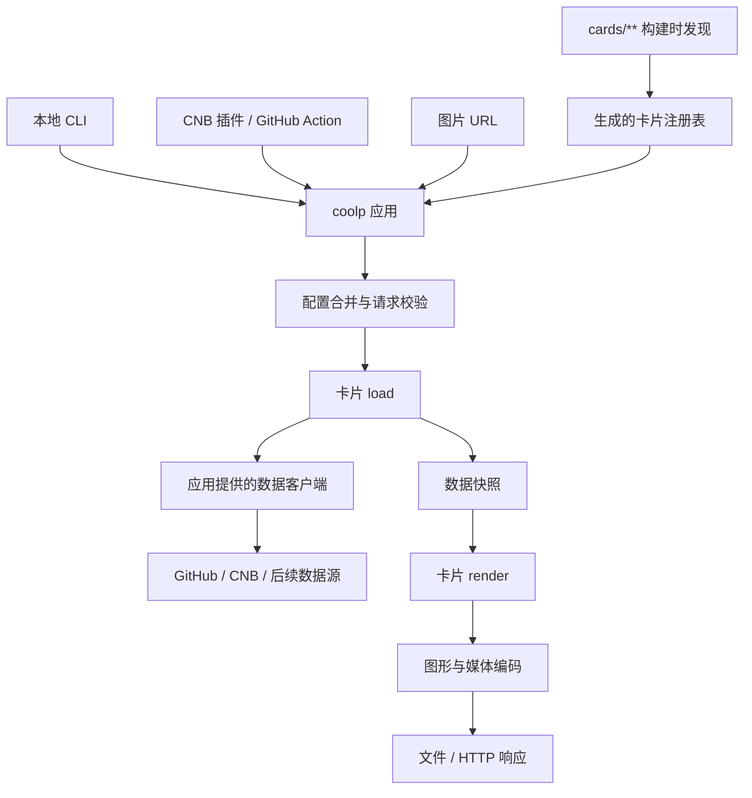

## 定位与范围

Cool Profile 将持续变化的信息生成为可嵌入个人主页、README 和网站的媒体卡片与动画。首期使用 GitHub 与 CNB 数据，重新实现贪吃蛇、太空射击、3D 活跃日历和统计卡片。后续接入 B 站、Steam 等来源，也允许一张卡片融合多种数据。

统一应用名为 `coolp`，包含 CLI 和 HTTP server。CNB 插件、GitHub Action 与服务部署共用应用和 OCI 镜像，通过子命令选择生成文件或启动服务。

当前已实现卡片协议、构建时发现、分层配置与来源诊断、可执行 coolp、HTTP 图片服务，以及 GitHub/CNB 的统计和日历数据适配器。`profile/stats`、`profile/languages`、`profile/radar`、`repository/overview` 提供中英文、67 个主题和 SVG/PNG 输出；`activity/snake` 提供五种主题和 SVG/GIF 动画。`activity/city` 支持组合图与独立日历、十一种主题、SVG/PNG 和 SVG 生长动画；`activity/shooter` 支持 GIF/WebP、三种策略和三种主题。应用通过统一 Dockerfile、CNB 插件和 GitHub Action 分发，画廊提供七张卡片的真实样张、参数编辑和实时生成。本文集中维护架构、卡片协议、配置、命令和 URL。README.md 默认中文，README.en.md 提供内容一致的英文版本。

## 职责与依赖



应用内一次生成依次完成配置解析、取数、绘制和编码，返回媒体内容、MIME、尺寸和动画信息。CLI 写文件，HTTP 路由返回响应。任务内的数据请求复用、跨请求缓存和凭证归应用管理。

| 路径                | 职责                                                               |
| ------------------- | ------------------------------------------------------------------ |
| `apps/coolp`        | CLI、server、配置、生成函数、注册表加载、缓存及交付                |
| `apps/gallery`      | 展示真实样张，根据卡片元信息生成命令、URL 和配置                   |
| `packages/card-kit` | 小型卡片协议：defineCard、上下文类型、参数 schema 约束及定义校验   |
| `packages/data`     | 数据能力、快照类型、适配器与认证、分页、限流；类型通过独立入口导出 |
| `packages/graphics` | 图元、排版、主题、语言格式化、时间轴及 SVG/PNG/GIF/WebP 编码       |
| `cards/**`          | 卡片代码包，各自维护参数、取数组合、布局或模拟、文案和样张         |

卡片依赖 card-kit、图形包及数据类型；应用装配具体数据客户端。load 可以调用该客户端组合多个数据源，HTTP 请求和令牌处理在数据适配器内完成。render 只消费已取得的快照，不访问网络、令牌或 Git。编码器按格式加载，图形与模拟代码不绑定 CLI 或 HTTP。

## 卡片 ID 与发现

卡片 ID 等于包目录相对于 `cards/` 的路径，使用 `/` 分隔。例如 `cards/activity/city` 的 ID 为 `activity/city`，`cards/profile/stats` 的 ID 为 `profile/stats`。单层目录也有效：`cards/example` 对应 `example`。每段使用小写 kebab-case，匹配 `[a-z0-9]+(?:-[a-z0-9]+)*`；不含空段、点或扩展名。

按卡片展示的内容组织目录：activity 是活跃日历效果，profile 是账号资料，repository 是仓库信息。目录名称表达产品中的功能，不沿用参考仓库的项目名，也不按当前数据源拆分同一种效果。融合卡片同样从自己的路径取得 ID，可组合多个数据源。

workspace 包含 `apps/*`、`packages/*` 和 `cards/**`。一个卡片包对应一个 ID，固定入口为 `src/index.ts`，默认导出 `defineCard(...)`。卡片代码、package.json 和样张清单都不声明 ID，npm 包名只用于 workspace 依赖管理。

```json
{
  "name": "@cool-profile/card-profile-overview",
  "private": true,
  "type": "module",
  "dependencies": {
    "@cool-profile/card-kit": "workspace:*",
    "@cool-profile/graphics": "workspace:*",
    "zod": "catalog:"
  }
}
```

发现脚本递归扫描卡片包，从目录计算 ID 并校验固定入口和单张卡片的默认导出。构建生成的注册表使用 `bindCard` 绑定路径与定义，随应用打包进 CLI 和镜像；运行时无须扫描文件系统。添加卡片只需创建符合约定的包并构建，无需编辑中心列表、HTTP 路由或帮助文本。移动目录即改变对外 ID，改动时同步命令、URL、配置、流水线及样张链接。

注册校验包括路径命名、ID 唯一性、入口与导出、格式/主题/语言列表、schema 可描述性、参数名冲突及默认值合法性。定义中自行提供 id 或重复绑定会报错。卡片模块的顶层初始化不请求网络或读取运行配置。

## 卡片协议与添加方式

参数使用 Zod 4 的严格对象 schema，作为 TypeScript 类型、运行时校验和参数说明的共同来源。通过 JSON Schema 导出字段类型和描述，供 CLI 帮助、URL 校验及画廊使用。card-kit 封装协议与定义校验。

以下是协议轮廓，Graphic、DataClient 等具体类型由对应包导出：

```ts
interface CardDefinition<S extends z.ZodObject, Data> {
  params: S;
  formats: readonly MediaFormat[];
  themes: readonly string[];
  locales: readonly string[];
  defaults?(media: MediaOptions): Partial<z.output<S>>;
  validate?(
    params: z.output<S>,
    media: MediaOptions,
    ctx: ValidationContext,
  ): readonly ValidationIssue[];
  load(ctx: LoadContext, params: z.output<S>): Promise<Data>;
  render(ctx: RenderContext, data: Data, params: z.output<S>): Graphic | Promise<Graphic>;
}
```

- formats 第一项为默认格式；themes 包含 default，locales 包含 zh-CN，首期卡片同时提供 en。
- params 定义卡片参数的类型、必填项、范围和说明；根字段使用小写 kebab-case。format、theme、locale、seed、params、tokens 及 CLI 控制选项是保留名，不能重复声明。
- defaults 只提供卡片参数的默认值，可根据已确定的媒体格式与主题选择，例如 3D 卡片在 SVG 的默认、南北季节主题下默认动画，PNG 下默认静态。schema 本身不使用 default、coerce 或 transform，避免在覆盖完成前补值或改变语义。
- validate 在完整参数解析后检查跨字段规则，例如 PNG 不接受 animate=true。ValidationContext 提供应用传入的 now；日历卡、个人统计与独立雷达复用数据包的年份与时区规则，未来年份在 CLI、URL 和 dry-run 中都会被拒绝。
- LoadContext 提供受控 DataClient、AbortSignal 和本次请求的时间基准。RenderContext 提供规范化媒体设置和 text 排版函数，图元由图形包提供；绘图上下文没有数据客户端。应用持有共享缓存，每次生成创建独立上下文与配置，卡片定义不保存请求状态。

`defineCard` 返回不含 ID 的 `CardModule`，构建时由发现步骤绑定路径，得到带 ID 的 `Card`。请求调用 `prepare` 时先获取快照，再得到保留类型信息的绘图函数。应用记录本次使用的快照版本及权限作用域，在绘图与编码之前查询媒体缓存。缓存仅属于应用实例；共享取数任务使用独立超时，某个 HTTP 客户端取消请求不取消其他消费者。

添加一张融合卡片时，在 `cards/profile/overview` 放入上述 package.json，并实现 `src/index.ts`、绘图代码及样张。以下示例使用首期选定的两个来源：

```ts
import * as z from 'zod';
import { defineCard } from '@cool-profile/card-kit';
import { drawOverview } from './draw.js';

export default defineCard({
  params: z.strictObject({
    'github-user': z.string().min(1).describe('GitHub 账号'),
    'cnb-user': z.string().min(1).describe('CNB 账号'),
  }),
  formats: ['svg', 'png'],
  themes: ['default', 'dark'],
  locales: ['zh-CN', 'en'],
  async load(ctx, params) {
    const [github, cnb] = await Promise.all([
      ctx.data.read({
        source: 'github',
        kind: 'profile-stats',
        subject: params['github-user'],
      }),
      ctx.data.read({
        source: 'cnb',
        kind: 'profile-stats',
        subject: params['cnb-user'],
      }),
    ]);
    return { github, cnb };
  },
  render(ctx, data) {
    return drawOverview(data, ctx);
  },
});
```

绘图模块根据 ctx.media.locale 和主题排版，保留 GitHub 贡献数与 CNB 活跃分各自的名称、单位和范围。

新增卡片的完成路径：

1. 在 `cards/<分类>/<名称>` 实现单张卡片的默认导出、绘图和依赖；所需能力未存在时，在 packages/data 增加对应适配器或能力。
2. 运行 workspace 安装与应用构建，由发现步骤生成注册表；使用 CLI 帮助检查格式、主题和参数。
3. 通过 CLI 与 URL 生成同一请求，验收中英文、多主题和数据边界，补充画廊样张。算法或数据行为有风险时增加针对性验证。

## CLI 与 URL

```text
coolp render <card-id> [--config <file>] [options]
coolp batch [--config <file>] [--output-dir <directory>] [render-options]
coolp serve [--config <file>] [--host <address>] [--port <port>]
```

```sh
coolp render profile/stats --source cnb --subject elonzh --format svg --theme dark --locale zh-CN --output dist/stats.svg
```

```text
GET /v1/cards/profile/stats.svg?source=cnb&subject=elonzh&theme=dark&locale=zh-CN
```

按上节添加融合卡片包后，可使用自己的参数，不必声明 source 或 subject：

```sh
coolp render profile/overview --github-user elonzh --cnb-user elonzh --format svg --locale zh-CN --output dist/overview.svg
```

```text
GET /v1/cards/profile/overview.svg?github-user=elonzh&cnb-user=elonzh&locale=zh-CN
```

命名空间同样适用于未来卡片，以下仅说明寻址规则：

```sh
coolp render bilibili/card-id --uid 123 --format png --output dist/bilibili.png
```

```text
GET /v1/cards/bilibili/card-id.png?uid=123
```

| 语义     | CLI                         | URL / 配置                         |
| -------- | --------------------------- | ---------------------------------- |
| 卡片     | render 后的位置参数         | 路径中完整 ID；批量项为 card       |
| 格式     | --format                    | 路径扩展名；配置为 render.format   |
| 主题     | --theme                     | theme；配置为 render.theme         |
| 媒体语言 | --locale                    | locale；配置为 render.locale       |
| 随机种子 | --seed                      | seed；配置为 render.seed           |
| 卡片参数 | schema 中的 --字段名        | 同名查询参数；配置为 params.字段名 |
| 输出文件 | --output / -o               | CLI 交付设置，不进入图片 URL       |
| 运行配置 | --config、--host、--port 等 | 本地配置与环境变量，不进入图片 URL |

公共渲染默认值为 locale=zh-CN、theme=default、seed=0，seed 范围为 0..4294967295；格式采用当前卡片的默认值。source、subject、year、fps、strategy 等都是卡片声明的参数。单来源日历卡可声明 source 与 subject，融合卡可声明多个账号或其他输入。浏览器、终端和服务器地区设置不改变媒体语言。

CLI 省略 format、URL 省略扩展名时采用同一默认格式。URL 在最后一段识别格式，前面的斜杠完整保留在 ID 中；仅对各段解码一次，不把百分号编码的斜杠转换成 ID 分隔符。URL 不再提供 format 查询参数。文件扩展名不参与选格式，冲突时报参数错误。CLI 默认输出 `<完整 card-id>.<format>`，保留子目录；`--output -` 将媒体写入 stdout，日志写入 stderr。

卡片参数按 schema 解析：字符串保留字符串含义，数值使用不含指数的十进制表示，布尔只接受 true/false；数组、对象和包含多种 JSON 类型的联合类型在 CLI/URL 中使用 JSON，URL 按查询参数编码。重复查询键、未知选项和不支持的组合报错。

新增卡片的参数也可整体放进 `--params '<JSON 对象>'`，URL 使用同名 params 查询参数。对象内容对应配置中的 params 区域；与单独字段重复提供同一个参数时报错。CI 元数据可通过这一个输入传递新卡片参数，无需为每张卡扩展固定 inputs。

### 首期效果

| ID                                                          | 展示                         | 参考                                                                                  | 默认 / 允许格式 |
| ----------------------------------------------------------- | ---------------------------- | ------------------------------------------------------------------------------------- | --------------- |
| `activity/snake`                                            | 活跃贪吃蛇                   | [Platane/snk](https://github.com/Platane/snk)                                         | svg / svg、gif  |
| `activity/shooter`                                          | 太空射击                     | [gh-space-shooter](https://github.com/czl9707/gh-space-shooter)                       | gif / gif、webp |
| `activity/city`、`profile/radar`                            | 3D 活跃城市、贡献雷达        | [github-profile-3d-contrib](https://github.com/yoshi389111/github-profile-3d-contrib) | svg / svg、png  |
| `profile/stats`、`profile/languages`、`repository/overview` | 个人统计、语言分布、仓库概览 | [github-stats-extended](https://github.com/stats-organization/github-stats-extended)  | svg / svg、png  |

参考用于理解算法与效果，代码重新实现。所有卡片同时支持 GitHub/CNB，统计卡使用来源实际提供的指标。github-stats-extended 的首期复现范围为 `profile/stats`、`profile/languages`、`repository/overview`，不包含 Gist 与 WakaTime；`profile/radar` 是 3D 活跃日历的独立配套图。

日历卡、个人统计和独立雷达缺省读取最近 365 天，year 指定来源时区下的日历年份；选择当年时截止到当天，不接受未来年份。累计指标保留原始统计范围。太空射击 strategy 支持 column、row、random，默认 random；fps 默认 40。3D 的 default、season、season-north、season-south 在 SVG 下默认启用生长动画，其余主题与 PNG 默认静态；SVG 可显式切换 animate。

`activity/shooter` 的 duration 默认 20 秒，允许 8..24；fps 允许 5..40。模拟按时间推进，与采样帧率独立。column 按列逐个清除，row 从底行向上清除，random 使用 seed 随机选列；每次命中该列最下方的存活目标。先瞄准、发射，目标耐久等于其活跃等级（1..4）；命中后降低耐久与色阶，最后一次命中才摧毁、爆炸并累计该日完整原始值。清除后飞船回到起点。

`activity/city` 的 layout=dashboard 为默认布局，输出 1280×850 组合图：3D 日历、贡献雷达、语言圆环、活跃总量及星标/Fork。layout=calendar 输出 1280×740 独立日历。雷达与日历使用同一年份窗口；语言与星标/Fork 是当前公开 Owner 仓库统计，并在图中保留单位。GitHub 雷达包含提交、议题、合并请求、评审、贡献仓库；CNB 仅绘制接口提供的前三项。独立雷达使用 `profile/radar`，独立语言图使用 `profile/languages` 的 pie 或 donut 布局。

城市主题为 default、dark、season、rainbow、blocks、season-north、season-south、night-view、night-green、night-rainbow、halloween。season 与 season-north 使用北半球月份，season-south 反转季节；night-view 使用深蓝楼体和暖色窗灯，night-green 使用绿色楼体，night-rainbow 按日期变化色相。blocks 使用四凸点屋顶、凸点投影、侧面阴影与逐层砖缝，楼高量化为砖层；零活跃日也保留积木底板。colors 可覆盖五级配色。SVG 的 animate 可关闭；PNG 的 animate 必须为 false。

`activity/snake` 的 fps 默认 20，可设为 5..40；duration 为一轮秒数，默认 12，可设为 4..30。路径以矩形闭合环为基础，捷径保持头尾在环上的顺序，按前进方向选择下一个活跃格，吃完后补齐完整身体姿态再循环。每个活跃日只消除一次，不把活跃分换算成贡献数。SVG 与栅格动画使用同一路径和消除时刻。提供 default、dark、rainbow、ocean、grey 主题；snake-color、colors（五项）、background-color 分别覆盖蛇、日历和背景颜色。

`profile/languages` 汇总公开 Owner 仓库，默认排除 Fork，可用 include-forks=true 纳入。GitHub 默认 metric=bytes，完整读取各仓库的语言字节数；CNB 默认 metric=repositories，按仓库主要语言计数。两端都支持 repositories，CNB 不接受 bytes。图中标明统计单位和已识别语言的仓库数，未识别语言的仓库不进入百分比分母。limit 默认 6、范围 1..20，超出部分合并为“其他语言”，总量保持不变。GitHub 语言颜色来自随应用分发的 Linguist 色表，CNB 优先使用接口颜色。

`repository/overview` 的 subject 为完整仓库路径：GitHub 使用 owner/repository，CNB 允许多层组织路径。卡片仅展示公开仓库，显示简介、主要语言、许可证、星标、Fork 和未关闭事项。GitHub 的 open_issues_count 包含合并请求，CNB 将 open_issue_count 与 open_pull_request_count 相加，图中统一标为“未关闭议题与合并请求”。有值时显示简介、语言与许可证。show-owner 控制完整路径标题，description-lines 为 1..5，layout=compact 收紧留白；数值与图标沿同一基线排布。

```sh
coolp render profile/languages --source github --subject elonzh --metric repositories --include-forks true --limit 8 --output languages.svg
coolp render repository/overview --source cnb --subject elonzh/cool-profile --theme dark --output repo.png
```

对应 URL：

```text
/v1/cards/profile/languages.svg?source=github&subject=elonzh&metric=repositories&include-forks=true&limit=8
/v1/cards/repository/overview.png?source=cnb&subject=elonzh%2Fcool-profile&theme=dark
```

图形包提供基础图元、时间轴和编码，各卡片维护自己的布局、模拟及文案。CNB 默认活跃色阶与徽章绿、GitHub 原生色阶，以及季节、夜景、彩虹、积木和游戏主题随效果实现。字体随镜像分发，每类效果以真实数据验收中英文与多主题样张。

### 展示能力与视觉约定

首期以这些参考版本为效果基线，Gist、WakaTime 保持排除：

| 参考                                                                                                                                | 效果范围                                                                                 | 本项目实现                                                                                |
| ----------------------------------------------------------------------------------------------------------------------------------- | ---------------------------------------------------------------------------------------- | ----------------------------------------------------------------------------------------- |
| [snk](https://github.com/Platane/snk/tree/a041d6c27ba561a39f5be9c26a784812765e434b)                                                 | SVG/GIF、明暗、自定义蛇/格子/背景色                                                      | `activity/snake`，增加彩虹、海洋和灰阶预设                                                |
| [gh-space-shooter](https://github.com/czl9707/gh-space-shooter/tree/b24c9792454d1a2e0139ccf72840424e1f83c3f2)                       | GIF/WebP、三种策略、多次命中、爆炸、飞船归位                                             | `activity/shooter`，保留明暗和街机主题，轨迹与 fps 独立                                   |
| [github-profile-3d-contrib](https://github.com/yoshi389111/github-profile-3d-contrib/tree/e235d118909be71eb7edb05482a3de4e76156df3) | 城市、积木、南北季节、夜景/绿色/彩虹、万圣节、雷达、语言圆环、组合/独立图、静态/生长动画 | `activity/city`、`profile/radar`、`profile/languages`；组合数据各自保留统计口径           |
| [github-stats-extended](https://github.com/stats-organization/github-stats-extended/tree/d130fe21d880fef33060082dffbfaa1a15445b37)  | stats 列表/等级环、五种语言图、repo pin、主题和外观参数                                  | `profile/stats`、`profile/languages`、`repository/overview`；另提供统计双列与仓库紧凑布局 |

`profile/stats`、`profile/languages`、`profile/radar`、`repository/overview` 共用 67 个主题 ID。参考主题色表以静态 JSON 数据分发，来源版本和 MIT 许可放在 `packages/graphics/assets/THEMES-LICENSE`；绘制、布局、协议和数据代码独立实现。default/dark 使用来源原生底色与色阶，CNB 默认浅色主题的强调色按下述可读性约定调整。颜色覆盖只接受十六进制或 transparent，主题中的多色背景由 SVG linearGradient 绘制。

这四张卡片共同支持表面参数 title、width（300..1200）、hide-title、hide-border、border-radius（0..40）、title-color、text-color、background-color、border-color；额外外观参数按各卡片 schema 提供：

| 卡片                                   | 额外外观参数                                                                             |
| -------------------------------------- | ---------------------------------------------------------------------------------------- |
| `profile/stats`、`repository/overview` | icon-color、line-height、show-icons、text-bold、number-format、number-precision、animate |
| `profile/languages`                    | line-height、number-format、number-precision、animate                                    |
| `profile/radar`                        | animate                                                                                  |

line-height 范围为 22..48，number-format 支持 short/long，number-precision 为 0..2。这四张卡片的 animate 缺省关闭，仅 SVG 播放动画，PNG 使用完整静态状态；活动卡片的参数由各自 schema 定义。个人统计的 hide/show 选择已有指标，hide-rank 控制等级环，rank-icon 在字母与估算百分位之间切换，ring-color 覆盖环色。计算等级是应用基于公开计数的计算结果，缺失项不参与权重；图中标为“计算等级”，不表述为平台官方排名。

语言图 layout 支持 normal、compact、donut、donut-vertical、pie。hide 在绘制前过滤语言，百分比分母使用过滤后总量；exclude-repo 在数据层聚合前排除完整仓库路径。hide-progress、hide-values、bar-background、stats-format 控制条形与数值。donut 布局在宽度低于 480px 时转为上下排列，donut-vertical 与 pie 始终上下排列；低于 440px 的图例使用单列。统计卡在宽度低于 440px 时把等级环放在指标下方，compact 布局的阈值为 560px；指标可用宽度不足 360px 时改为单列，300px 卡片以单列指标和下方等级环展示。

卡片内容本身承担表达，图形由 SVG 图元与字体路径组成。3D 组合卡保持大尺度斜投影与留白，雷达放右上、语言放左下，统计摘要沿底部；统计与仓库卡使用无装饰色块的紧凑列表，共用 6px 默认圆角和 26px 水平内边距。标题为 18px，统计指标标签为 13px、数值为 14px，仓库指标为 12px，图标与数值按基线排布。配色保留 CNB 原生橙色活跃阶与蛇的身份徽章绿（#07b87d）；CNB 默认浅色统计主题的标题、等级环与功能图标使用深绿 #007a52，白底对比度约 5.38:1，正文仍使用深灰。GitHub 保留原生绿色阶；避免全卡重复品牌页脚。中文/英文共享几何结构和随应用分发的字体路径。

每个包的 examples/manifest.json 维护实际请求；不同布局使用独立 case，主题和媒体语言从文件名识别。`pnpm examples:generate [card-id...]` 使用环境中的令牌与真实公开数据生成中英文样张，CLI、URL、插件和 Action 都消费同一 schema、布局与默认值。验收覆盖原始尺寸、README 缩小尺寸、300px 窄卡、两种语言和来源；数据、图形及传输一致性由有针对性的测试验证。

## 配置结构与下发

配置按作用域区分：

| 区域             | 内容                                                   | 可由图片请求覆盖             |
| ---------------- | ------------------------------------------------------ | ---------------------------- |
| runtime          | server、日志、数据客户端、缓存、凭证引用、文件输出目录 | 否                           |
| defaults         | 所有卡片的公共渲染默认值：format、theme、locale、seed  | 是                           |
| cards[id].render | 指定卡片的公共渲染设置                                 | 是                           |
| cards[id].params | 指定卡片的业务参数，受该卡片 schema 约束               | 是                           |
| jobs[]           | batch 的 card、render、params、output                  | CLI batch 公共渲染选项可覆盖 |

defaults 只接收公共渲染字段，不向所有卡片广播 source 等业务参数。cards 的键始终是完整 ID，带斜杠时作为普通字符串键。runtime 中的凭证、服务地址与缓存设置不进入卡片 schema。

配置支持 YAML 与 JSON，结构相同。示例 coolp.yaml：

```yaml
runtime:
  server:
    host: 127.0.0.1
    port: 3000
  log-level: info
  output-dir: dist
  render-concurrency: 1
  cache:
    ttl: 300
  providers:
    github:
      token-env: GITHUB_TOKEN
    cnb:
      token-env: CNB_TOKEN

defaults:
  locale: zh-CN
  theme: default

cards:
  profile/stats:
    render:
      theme: dark
    params:
      source: cnb
      subject: elonzh

jobs:
  - card: profile/stats
    output: cnb-stats.svg
  - card: profile/stats
    render:
      locale: en
    params:
      source: github
      subject: elonzh
    output: github-stats.svg
```

配置文件选择顺序为 `--config`、插件的 PLUGIN_CONFIG、`COOLP_CONFIG`、当前目录的 coolp.yaml / coolp.yml / coolp.json。应用入口选定显式路径后交给共用加载器；自动发现只检查当前目录，存在多个候选文件时报错。render 与 serve 没有文件时使用内置默认值及环境变量，batch 需要有 jobs 的配置。显式指定的文件不存在时报错。

配置文件中的相对路径以文件目录为基准，CLI 或环境变量中的相对路径以工作目录为基准。batch 的 output 相对最终 output-dir 解析，重复输出目标在生成前报错。render 不读取 jobs 中的参数；batch 按每项 card 选择对应定义；serve 不执行 jobs。

### 环境变量

runtime 和 defaults 使用 `COOLP__<区域>__<字段>`，双下划线分层，字段转大写并将连字符转为单下划线。cards 使用一个 JSON 对象覆盖映射，ID 保持原样：

```sh
export COOLP__RUNTIME__SERVER__PORT=8080
export COOLP__RUNTIME__LOG_LEVEL=debug
export COOLP__DEFAULTS__LOCALE=en
export COOLP__CARDS='{"profile/stats":{"params":{"subject":"another-user"}}}'
```

COOLP__CARDS 的值与文件的 cards 区域同构，可同时设置多张卡的 render 和 params，也支持含斜杠的 ID。这样无需把 ID 编码成有歧义的环境变量名。数组和对象使用 JSON，标量依据 schema 转换；空字符串保留为空值，不能隐式表示未配置。未知 COOLP__ 字段报错。其他应用或系统环境变量不参与参数合并。

同一组环境变量不能同时给父对象和子字段赋值，例如 COOLP__RUNTIME__SERVER 与 COOLP__RUNTIME__SERVER__PORT 同时存在会报冲突，避免覆盖取决于变量枚举顺序。

provider 的 token-env 指定凭证环境变量名，GitHub/CNB 默认分别使用 GITHUB_TOKEN、CNB_TOKEN；使用数据源时按适配器的认证要求解析，未使用的来源不强制提供凭证。不执行通用字符串插值。凭证值不属于请求参数，错误和配置预览均脱敏。

runtime.render-concurrency 控制同一应用内同时绘图、编码的数量，默认 1，允许 1..8，也可用 COOLP__RUNTIME__RENDER_CONCURRENCY 设置。数据读取仍可并行；相同媒体请求先去重再排队，命中缓存时不占编码名额。此配置属于部署资源设置，图片 URL 不能覆盖。

### 覆盖顺序

运行配置按以下顺序覆盖，右侧优先：

```text
应用内置 runtime 默认值
  < 文件 runtime
  < COOLP__RUNTIME__*
  < 插件运行设置
  < 启动命令的运行选项
```

单张卡的生成配置按以下顺序覆盖，右侧优先：

```text
公共媒体默认值与卡片 defaults
  < 文件 defaults
  < 文件 cards[完整 ID]
  < 当前 batch job
  < 环境 defaults
  < 环境 cards[完整 ID]
  < CNB 插件 settings 输入
  < 显式 CLI 参数或 HTTP 请求
```

先按相同来源内的作用域合并，再按来源优先级覆盖。因此环境中的全局 locale 可以覆盖文件中某张卡的 locale，URL 中的 locale 又能覆盖环境值。CLI 与 URL 的最终请求使用同一套函数，不从进程全局状态修改卡片定义。

以上述文件和环境变量为例，执行 `coolp render profile/stats --locale zh-CN --dry-run` 会得到 source=cnb、subject=another-user、theme=dark、locale=zh-CN：账号来自环境的卡片配置，主题来自文件的卡片配置，语言来自本次命令。

先确定媒体设置，再用这些设置计算卡片参数 defaults，最后应用各层 params。defaults 函数只确定最低优先级的值，不能覆盖用户参数。对象递归合并，标量与数组整体替换；字段缺省表示沿用低层，null 仅在 schema 明确允许时有效，不作为删除指令。

batch 的 --locale、--theme、--format、--seed 覆盖每项公共媒体设置；卡片参数在各 job 或 cards[id].params 中配置，batch 不接受某一张卡专属的命令参数。serve 的启动选项只配置 runtime，每个请求的卡片参数由 URL 指定并覆盖部署默认值。

CNB settings 转为 PLUGIN_* 后，由 render 的输入适配器读取，card 可来自 PLUGIN_CARD。公共字段映射到媒体、交付或运行设置，其余字段按当前卡片 schema 映射到 params。适配器将环境变量名中的下划线归一为连字符，也接受保留连字符的键；归一后重复的字段会报错。PLUGIN_PARAMS 支持整个 params 的 JSON，同一字段同时由 PLUGIN_PARAMS 和独立 settings 提供时报重复输入错误。GitHub Action inputs 映射为命令参数。此适配层不再定义一套默认值。

插件的 tokens 是 provider 名称到令牌的对象，CNB 转换为 PLUGIN_TOKENS 的 JSON 字符串。完成运行配置合并后，应用将每个值放入对应 provider.token-env 指定的内存环境副本；它覆盖该变量的原值，不修改进程环境，也不进入配置、请求、dry-run 或错误内容。未知 provider、缺少 token-env、空令牌、重复键及非法 JSON 均报错。系统内置 CNB_TOKEN 可直接使用；从密钥仓库导入的令牌通过 settings.tokens 显式引用。

### 校验与诊断

1. 读取每个配置来源时检查结构、未知卡片 ID、未知字段、键重复、类型及当前可判定的范围。配置片段的对象递归允许缺省字段，只检查已提供的内容，不在本层填默认值或执行跨字段校验；错误即报告，不被更高层覆盖掩盖。
2. 合并选中卡片的媒体设置，验证格式、主题、语言等能力；再计算默认参数、合并 params，执行完整 schema 和跨字段校验。缺失必填值在此时报错。
3. batch 在取数前校验所有 job 和输出目标。serve 在开始监听前校验 runtime 和卡片默认配置片段，卡片必填参数允许由请求补齐；每个请求再检查覆盖后的完整值。各次生成使用独立的不可变配置。
4. 错误包含字段路径、来源和原因，例如 `COOLP__RUNTIME__SERVER__PORT: expected integer 1..65535` 或 `coolp.yaml: cards["activity/snake"].params.subject: required`；所有来源信息保留到规范化完成，凭证值脱敏。

`coolp render <id> --dry-run` 与 `coolp batch --config coolp.yaml --dry-run` 输出最终配置、字段来源和目标文件，完成同样的校验，不调用数据源或编码器。serve 首期在启动时读取文件和环境，不自动热更新配置。

## 数据、媒体与 server

数据按日历、资料、统计、仓库等能力组织，卡片按需组合快照。资源由来源、服务地址、来源内 ID 标识；数据请求缓存键包含能力、资源、查询与权限作用域。快照保留采集时间、版本、权限作用域，以及数据内的缺失值、单位和统计范围。

时间窗口显式解析，绘制和模拟使用已固定的数据、语言、主题、时间与随机种子，避免依赖机器时区及系统时间。GitHub 日历按 UTC 日期、CNB 按 Asia/Shanghai 日期解析。个人统计、独立雷达和城市组合图的时间指标与日历使用同一最近 365 天或显式 year 窗口：GitHub 读取提交、议题、合并请求、评审及贡献仓库的平台计数，CNB 汇总日历中的提交、议题与合并请求。CNB 不提供评审与贡献仓库计数，这两项保留缺失值，雷达省略相应轴；获赞和被 Fork 汇总完整分页的公开 Owner 仓库，公开仓库数使用平台资料字段。CNB 活跃分与 GitHub 贡献数保留各自名称与等级语义。HTTP、响应结构或认证失败直接报错，不替换成零值。

每个 provider 的 concurrency 默认 4、范围 1..16，限制该来源共享 HTTP 客户端的并发请求；例如 runtime.providers.github.concurrency 或 COOLP__RUNTIME__PROVIDERS__GITHUB__CONCURRENCY。缓存命中不占请求槽，失败释放槽位。runtime.render-concurrency 独立限制绘制与编码，两者都只从运行配置下发，不允许 URL 覆盖。CNB 日历与用户统计使用 account-profile:r、account-engage:r；repo 还使用 repo-basic-info:r。GitHub 统计与日历需要令牌，公开仓库和语言 REST 接口支持无令牌访问。

Noto Sans SC、Noto Emoji 可变字体及各自的 OFL 授权文件随应用放在 assets/fonts。Fontkit 按字素选择具有对应字形的字体，将连续同字体文本一起排版，生成文字矢量路径；中英文与单色 Emoji 共用测量、换行、对齐和省略逻辑，连接符组合不被拆开。SVG 保留可访问名称，渲染时不依赖系统字体或外部字体服务。PNG 由 resvg-js 使用同一份 SVG 生成。GIF/WebP 逐帧绘制并压缩为 PNG，再由 sharp 连接为动画，保留总时长和无限循环；GIF 按累计时间舍入到百分之一秒，避免 40 fps 的帧间隔取整后改变速度；WebP 保留毫秒精度。原生编码依赖从 bundle 外加载，应用包声明运行依赖。

server 本地默认监听 127.0.0.1:3000，容器显式使用 host=0.0.0.0。GET/HEAD `/v1/cards/<完整 ID>[.<format>]` 交付媒体，设置 Content-Type 与基于内容的 ETag，支持缓存和条件请求。媒体缓存键包含最终规范化参数、数据版本、权限作用域和渲染版本，不包含 CLI 文件位置。

CLI 参数错误退出码为 2，生成失败为 1；HTTP 参数错误返回 400，卡片或资源不存在返回 404，上游调用失败返回 502，错误使用结构化 JSON。runtime 字段和访问令牌不能从 URL 注入。

## 镜像与 CI

镜像 `docker.cnb.cool/elonzh/cool-profile:latest` 包含 coolp、server、编码器与字体。Dockerfile 先构建 bundle，再用 pnpm deploy --prod --legacy 收集生产依赖和应用文件；runtime 不依赖 workspace 或 pnpm：

```dockerfile
ENTRYPOINT ["coolp"]
CMD ["--help"]
```

```sh
docker run --rm -p 3000:3000 docker.cnb.cool/elonzh/cool-profile:latest serve --host 0.0.0.0 --port 3000
```

CNB 插件运行同一镜像：

```yaml
$:
  web_trigger:
    - stages:
        - name: generate-profile
          image: docker.cnb.cool/elonzh/cool-profile:latest
          args: [render]
          settings:
            card: activity/snake
            source: cnb
            subject: elonzh
            format: svg
            theme: dark
            locale: zh-CN
            output: dist/snake.svg
```

root action.yml 引用同一镜像，entrypoint 指向随应用打包的 action.mjs；它将非空 inputs 逐项作为 coolp render 的命令参数传入，不经过 Shell。github-token 默认使用 github.token，cnb-token 可选，分别放入 GITHUB_TOKEN、CNB_TOKEN；自定义 token-env 可通过 workflow env 设置。空媒体输入沿用应用配置，新增卡片的业务参数统一使用 params JSON。

CNB 插件使用镜像默认 ENTRYPOINT coolp，args 追加子命令 render 或 batch；server 通过 serve 启动。根 plugin-meta.json、README.md、README.en.md 组成插件市场贡献材料。CI 生成工作区文件，Git 提交、制品上传和部署由后续流水线步骤负责。

双端 PR 与 main 构建检查代码、构建最终镜像，并运行 scripts/verify-image.mjs：在容器内启动本地 API，逐字节比较 CLI、插件、Action 与 HTTP 的 PNG，验证条件请求、字体及 GIF/WebP 动画编码。CNB main 通过同步的 cnb:apply 任务并行调用 amd64、arm64 原生节点，分别构建、验证和推送架构标签；全部成功后合并为提交 SHA 的 manifest，再发布为 edge。父流水线串行执行，避免旧构建覆盖新镜像。最后通过真实 CNB 插件任务读取当前仓库，生成 PNG。GitHub 的 Action smoke test 支持手动触发，实际拉取发布镜像并生成公开仓库 PNG。仓库流水线镜像使用 latest 等浮动标签。main 的应用镜像使用 edge，正式版 latest 只由版本发布更新。

## 画廊

apps/gallery 是 Vite + TypeScript 应用，从构建时生成的卡片目录读取参数 schema、格式、主题、语言和样张。浏览器不加载绘图模块、原生编码器、数据适配器或令牌。CLI、URL 和画廊复用 card-kit 的 JSON/YAML、参数线格式及媒体校验；运行配置的覆盖与状态仍由 coolp 管理。

卡片包可在 examples/manifest.json 描述展示名称和样张请求，不需要修改中心列表：

```json
{
  "name": { "zh-CN": "贪吃蛇", "en": "Snake" },
  "cases": [{ "pattern": "cnb-*", "params": { "source": "cnb", "subject": "elonzh" } }]
}
```

pattern 匹配 examples 下的媒体文件，文件名以 `-<theme>.<locale>.<format>` 结束。构建从包目录取得所属卡片，校验请求参数和媒体组合，并生成静态首帧预览；没有 manifest 的卡片仍按 ID 和 schema 展示。样张与请求元信息随包维护，新增包会自动进入画廊。

默认画廊产物写入 apps/coolp/assets/gallery，随应用镜像和 npm 包分发，由 server 根路径交付。用户选择样张、编辑参数、切换主题和媒体语言后，可生成图片、下载或复制等义的 CLI、URL、coolp.json。空参数交由服务配置和卡片默认值补齐。界面语言独立于媒体语言，默认均为中文。

pnpm gallery:build 使用 pages 模式，将同一画廊构建到 apps/gallery/dist；资源使用相对路径，适配 GitHub Pages 的 /cool-profile/ 子路径。该模式展示已生成样张，允许编辑参数并复制 CLI 或配置，隐藏依赖 server 的“生成图片”和 URL 页签。普通 server 构建保留实时生成、下载和图片 URL。Pages 不接收令牌、不访问数据源。

.github/workflows/pages.yml 在 main 更新或手动触发时构建静态画廊，通过 Pages artifact 部署到 https://elonzh.github.io/cool-profile/，使用 github-pages 环境。仓库 Pages 的 Source 设置为 GitHub Actions，部署任务仅授予 pages:write、id-token:write；代码构建与部署分开。

### Direction contract

- THESIS：先看到真实卡片，再将自己的数据带入；样张和实时结果有明确状态。
- OWN-WORLD：沿用现有卡片的明暗效果，以冷白工作界面、深灰正文和绿色操作色承载。使用者在桌面上编辑主页，浅色表单便于读取代码，暗色属于可选择的媒体主题。
- STORY：选择效果与样张账号，调整参数，生成图片或复制使用方式；所有入口围绕这条路径。
- FIRST VIEWPORT：桌面左侧为完整效果预览及实际样张选择，右侧为参数与生成操作，下方展示 CLI、URL 和配置。手机按预览、参数、使用方式排列，保留完整图幅。
- FORM：基于现有卡片视觉直接实现作品预览与参数编辑；不增加独立品牌插图。效果自身承担动画，减少动态偏好下以静态首帧展示。
- FINISH：以桌面、手机实际操作验收、独立评审和本文件中的界面约定作为交付条件；正式说明只维护本文件。

### 界面约定

颜色由 apps/gallery/src/tokens.css 维护，组件与响应式布局由 apps/gallery/src/style.css 维护。画廊使用浅色工作界面；深色主题作用于媒体和预览画布。

| 用途                     | 当前值                                                                |
| ------------------------ | --------------------------------------------------------------------- |
| 页面、表面、画布         | `--page: #f8fafb`、`--surface: #fff`、`--canvas: #edf1f3`             |
| 正文、辅助文字、代码     | `--ink: #18272e`、`--muted: #53656e`、`--code: #244b43`               |
| 边线、滚动条             | `--line: #d5dfe3`、`--scroll: #9baeb7`                                |
| 操作、悬停、选中底色     | `--green: #087e58`、`--green-hover: #076346`、`--green-tint: #eaf5ef` |
| 文本选区、错误           | `--selection: #b8e8d4`、`--error: #a62a32`                            |
| 深色媒体画布、空状态文字 | `#182126`、`#c4d0d7`                                                  |

正文使用系统无衬线字体栈，字号 14px、行高 1.55；品牌标题 25px/700，效果标题 21px/600，自定义标题 18px。表单标签与主要操作辅助文字为 12px，代码使用系统等宽字体栈、12px 和 1.9 行高。界面以色面和 1px 边线分区，不使用投影；画布圆角 16px、效果选项 12px、表单 7px、生成按钮 8px。字段间距 16px，区段间距主要为 22–24px。

内容最大宽度 1440px，桌面左右内边距 48px；预览与输出占左列，320px 参数列靠右并在距顶部 24px 处吸附，两列间距 40px。宽度不超过 1050px 时内边距减为 28px、参数列 280px、列间距 28px。宽度不超过 760px 时改为预览、参数、使用方式的单列顺序，左右内边距 20px，参数区域取消吸附；主参数分两列，格式、主题、语言分三列，输入字号提高到 16px。预览始终等比完整显示；手机画布高 220px，效果列表横向滚动。

- 选择效果或样张会填入对应请求参数；表单从 schema 生成，其余参数收纳在“更多参数”。参数或媒体设置变化时，立即更新 CLI、URL 和 coolp.json，取消待处理请求并返回样张预览。空值不写入请求。
- 样张按主题、媒体语言匹配，优先使用所选格式，否则显示该组合已有格式；状态标明样张账号及实际格式。仅点击“生成图片”才请求实时结果，生成期间按钮禁用且表单标记忙碌；成功后显示“生成结果”并提供下载，失败在表单内报告。无匹配样张时显示空状态。
- 效果选项用绿色边线及浅绿底标识选中，使用方式页签用绿色下划线标识当前项。所有可聚焦控件的键盘焦点为绿色 3px 外框、偏移 3px；页签支持方向键及 Home/End。复制成功原位反馈，失败提示可选中文本复制；参数无效时禁用复制，状态消息通过 polite live region 报告。
- 界面语言由 `ui=zh-CN|en` 选择，与媒体语言独立。动画有播放/停止操作；遵循减少动态偏好时，样张显示静态首帧，实时动画等待用户主动播放，同时关闭界面动画、过渡和滚动动效。

## 工程与实施

Node.js 24+、TypeScript、pnpm workspace 与 catalog，内部依赖用 workspace 协议。Oxlint、Oxfmt 和 prek 已配置。卡片参数使用 Zod 4，tsx 执行发现脚本，Vitest 验证行为，tsdown 打包 ESM 可执行文件。画廊使用 Vite 与 TypeScript。esbuild 的依赖安装脚本仅在项目 allowBuilds 中启用，用于 tsx 执行 TypeScript，不安装全局工具。

```sh
pnpm install --frozen-lockfile
pnpm hooks:install
pnpm check
pnpm cards:discover
pnpm build
pnpm coolp render profile/stats --source cnb --subject elonzh --output stats.svg
pnpm sync:remotes
```

格式及风格检查交给提交钩子，修复后检查差异、重新暂存再提交。功能验证覆盖注册发现、配置覆盖与类型转换、CLI/URL 请求一致性、数据语义、确定性模拟、文字与图形边界及媒体交付。测试针对行为风险，不为简单配置堆叠实现镜像式断言。

pnpm cards:discover 校验 cards/** 的实际导出并生成应用注册表 generated/cards.ts、画廊目录 generated/card-catalog.ts 和样张首帧。generated/ 不提交到 Git，CI 检查会重新生成。

pnpm build 依次执行卡片发现、画廊构建和 CLI bundle，画廊写入 apps/coolp/assets/gallery，CLI 写入 apps/coolp/dist/coolp.mjs；该文件可直接通过 Node 或其 shebang 运行。开发时 pnpm coolp 执行 CLI TypeScript 入口，pnpm gallery:dev 启动画廊并将 /v1 请求代理到本地 coolp server。完整检查在测试前构建，CLI 集成测试执行真实 bundle，HTTP 测试使用本地 API 服务，不依赖外部令牌；真实样张保存在各卡片包的 examples/。

origin 为 [CNB](https://cnb.cool/elonzh/cool-profile)，github 为 [GitHub](https://github.com/elonzh/cool-profile)。两个远程共用 main、提交历史和版本号；pnpm sync:remotes 顺序推送，完成后核对两个远程 SHA。提交使用中文 Conventional Commit 标题，正文说明实现与验证。

## 版本与分发

根 package.json 的 version 是版本来源，apps/coolp/package.json 保持同值，使 coolp --version 与响应元数据一致。内部 workspace 包保持私有，只发布一个 npm 包 cool-profile；包内同时提供 CLI、server 和画廊。版本使用不含构建元数据的 SemVer，对应 Git 标签 v<version>。

```sh
pnpm release:prepare 0.1.0
pnpm check
pnpm release:pack
pnpm release:verify
# 提交版本与实现，正文记录验证；同步 main 到两个远程后：
pnpm release:tag
```

prepare 只修改两个版本清单。pack 从已构建应用整理发布目录，解析 catalog 中 sharp、resvg 的原生依赖版本，复制 bundle、画廊、字体、Action 入口与许可证，生成可独立安装的 npm tarball、release.json 和 SHA256SUMS。不发布 workspace 源码或内部包。verify 在临时目录安装真实 tarball，检查 coolp --version、字体及许可，并通过本地数据源验证 CLI PNG 与 server PNG 一致，结束后删除临时目录。tag 要求干净的 main 与两个远程 main 的 SHA 一致，创建同一个注解标签并顺序推送到 CNB、GitHub。

.github/workflows/release.yml 响应 v* 标签，也可手动指定已有标签重试；校验标签、清单版本和 main 的祖先关系。发布产物先经过完整检查及独立安装验证，再上传工作流制品。镜像在 GitHub 原生 amd64、arm64 runner 分别构建，验证容器内 CLI、CNB 插件、Action 与 HTTP 的输出，成功后推送对应架构标签，最后组合多架构 manifest。Dockerfile 使用与 npm 包相同的暂存目录及原生依赖；CLI、server、插件不拆分镜像。

| 渠道           | 正式版示例                                                     | 预发布版                    |
| -------------- | -------------------------------------------------------------- | --------------------------- |
| npm            | cool-profile@0.1.0，latest                                     | 0.2.0-beta.1，next          |
| Docker Hub     | elonzh/cool-profile:0.1.0，以及 0.1、0、latest                 | 0.2.0-beta.1、next          |
| CNB 镜像       | docker.cnb.cool/elonzh/cool-profile:0.1.0，以及 0.1、0、latest | 0.2.0-beta.1、next          |
| GitHub Release | v0.1.0：tarball、release.json、SHA256SUMS                      | 同名标签，标记为 prerelease |

CNB main 流水线独立发布提交 SHA 和 edge，开发构建不覆盖正式版 latest。所有流水线基础镜像使用浮动标签。GitHub Action、CNB 插件与用户的 server 使用同一应用镜像。

发布凭证配置在 GitHub 仓库设置中，不写入仓库、构建产物或画廊：

| 类型           | 名称                   | 用途                                                            |
| -------------- | ---------------------- | --------------------------------------------------------------- |
| Secret         | DOCKERHUB_TOKEN        | 推送 elonzh/cool-profile 的 Docker Hub 令牌                     |
| Variable       | DOCKERHUB_USERNAME     | Docker Hub 用户名，当前为 elonzh                                |
| Secret         | CNB_REGISTRY_TOKEN     | 具有该仓库制品推送权限的 CNB 令牌                               |
| Variable，可选 | CNB_REGISTRY_USERNAME  | CNB registry 登录用户名，默认 cnb                               |
| Secret         | NPM_TOKEN              | 有 cool-profile 发布权限的 npm granular token；首次创建包时使用 |
| Variable，可选 | NPM_TRUSTED_PUBLISHING | npm 已配置可信发布者后设为 true，可替代 NPM_TOKEN               |

npm 可信发布者指定 GitHub 仓库 elonzh/cool-profile 与工作流 release.yml，允许直接 npm publish；新的可信发布配置默认可能只允许暂存发布，须在 npm 包设置中启用直接发布。工作流使用 GitHub hosted runner、Node.js 24 和 npm 11.5.1+，授予 id-token:write 并附带 provenance。初次发布创建包后可切换到可信发布。npm 已存在相同版本时核对 tarball integrity，一致才继续后续渠道，否则停止，避免将不同内容视为同一版本。重试旧版本时，仅当 npm 当前频道仍指向该版本才更新镜像浮动别名，以免回退正在使用的版本。GitHub Release 只上传已校验的同一组产物。

缺少发布配置时，版本工作流在构建和验证产物后停止，尚未开始 npm 与镜像推送；Pages 独立部署。npm 与多个 registry 不提供跨服务事务，部分发布失败通过同一标签重试完成，不删除或重写已发布的 npm 版本。

## 技术依据

- [Zod 严格对象、类型推导和校验](https://zod.dev/api)、[JSON Schema 导出](https://zod.dev/json-schema)
- [YAML 配置解析](https://github.com/eemeli/yaml)
- [Fontkit](https://github.com/foliojs/fontkit)、[Noto Sans SC](https://github.com/google/fonts/tree/main/ofl/notosanssc)
- [GitHub 用户 API](https://docs.github.com/en/rest/users/users)、[仓库 API](https://docs.github.com/en/rest/repos/repos)、[CNB Open API](https://docs.cnb.cool/zh/develops/openapi.html)
- [pnpm workspace](https://pnpm.io/workspaces)、[catalog](https://pnpm.io/catalogs)
- [Oxlint](https://oxc.rs/docs/guide/usage/linter/config)、[Oxfmt](https://oxc.rs/docs/guide/usage/formatter/config)、[prek](https://prek.j178.dev/local-hooks/)
- [tsdown](https://tsdown.dev/)、[Vitest](https://vitest.dev/)、[Vite](https://vite.dev/)
- [GitHub Pages 自定义工作流](https://docs.github.com/en/pages/getting-started-with-github-pages/using-custom-workflows-with-github-pages)、[npm 可信发布](https://docs.npmjs.com/trusted-publishers/)、[Docker 多平台构建](https://docs.docker.com/build/building/multi-platform/)
- [resvg-js](https://github.com/thx/resvg-js)、[sharp](https://sharp.pixelplumbing.com/)
- [CNB 插件 settings](https://docs.cnb.cool/zh/build/create-plugin.html)、[Job args](https://docs.cnb.cool/zh/build/grammar.html#job-args)
- [GitHub Docker Action args](https://docs.github.com/en/actions/reference/workflows-and-actions/metadata-syntax#runsargs)、[Docker ENTRYPOINT 与 CMD](https://docs.docker.com/reference/dockerfile/#understand-how-cmd-and-entrypoint-interact)

语言色表提取自 [GitHub Linguist languages.yml](https://github.com/github-linguist/linguist/blob/681a3171a3f8d1ccab93e646e7753cba42186915/lib/linguist/languages.yml)，授权保存在 packages/data/assets/linguist-LICENSE。
